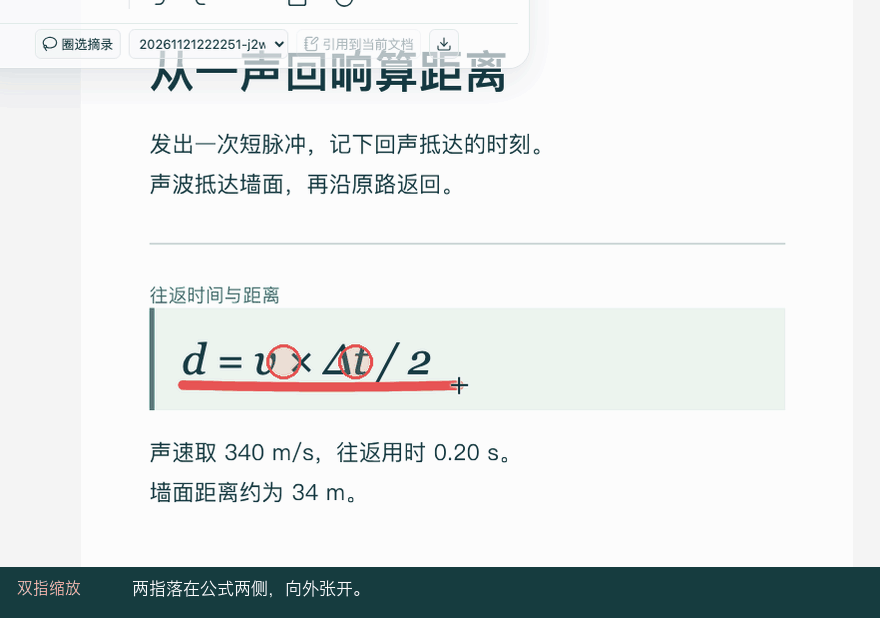
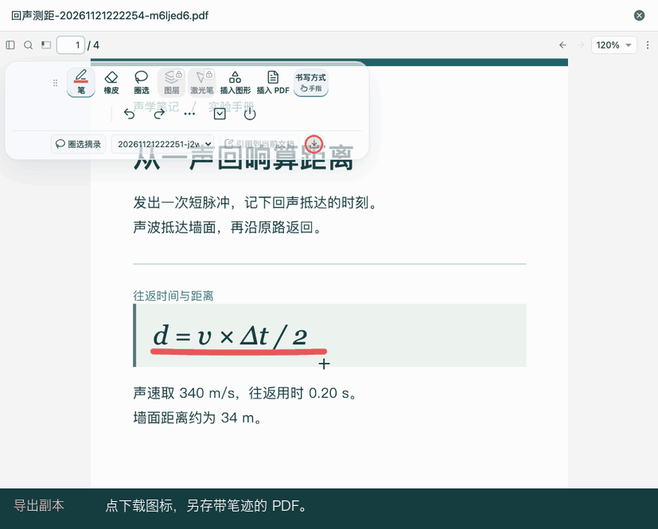
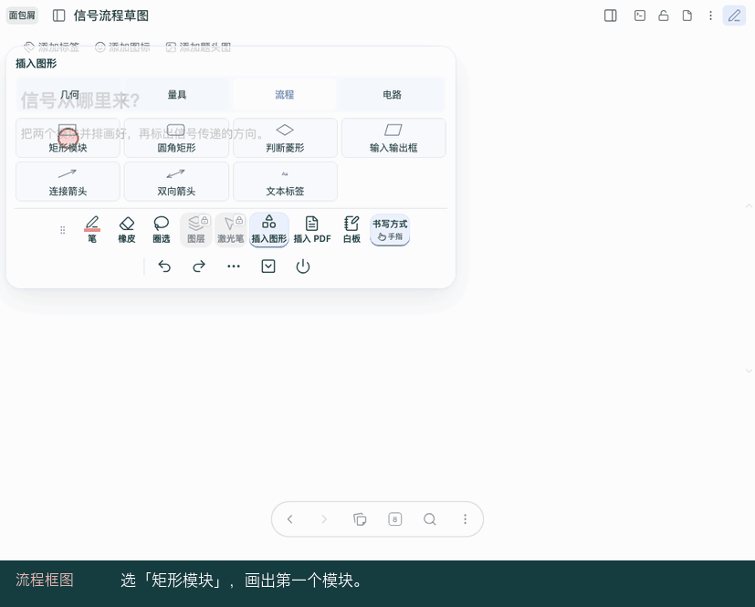
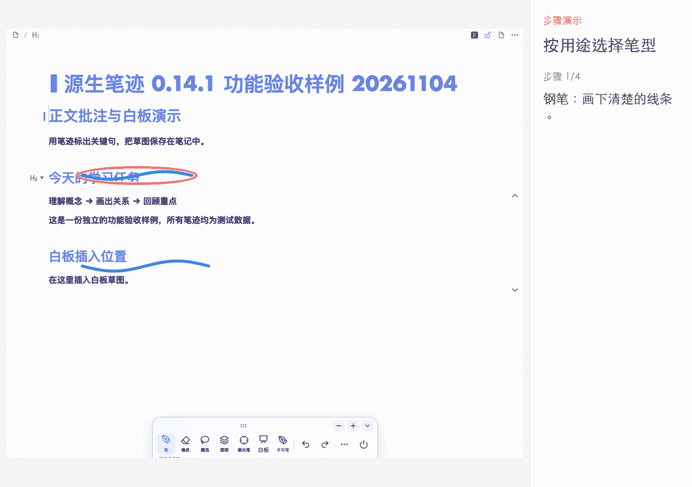
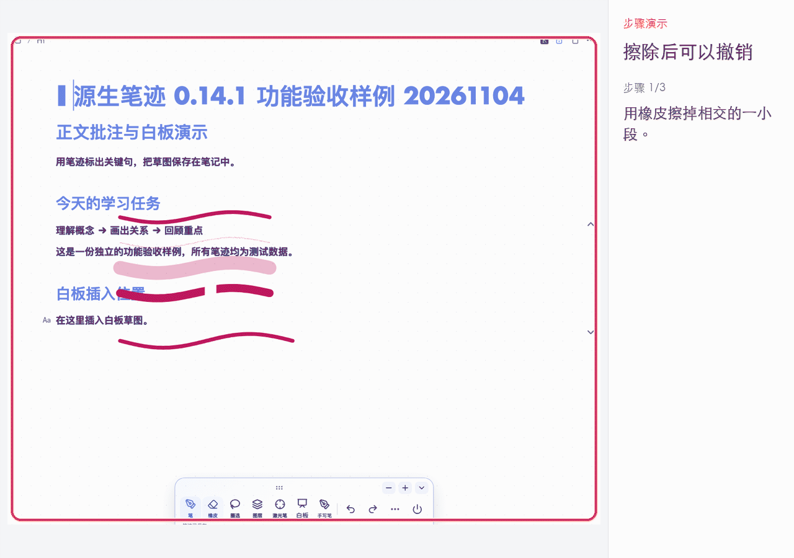
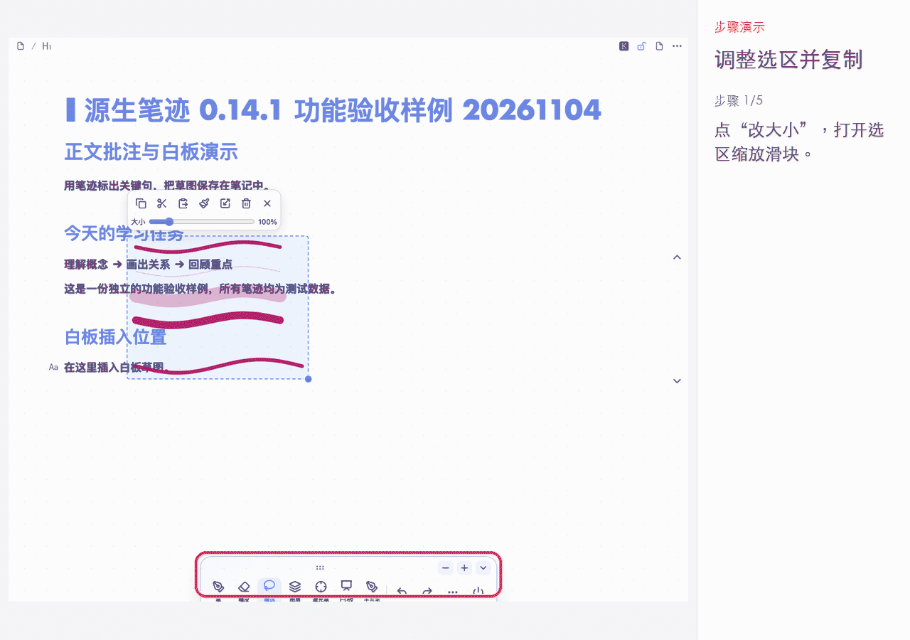
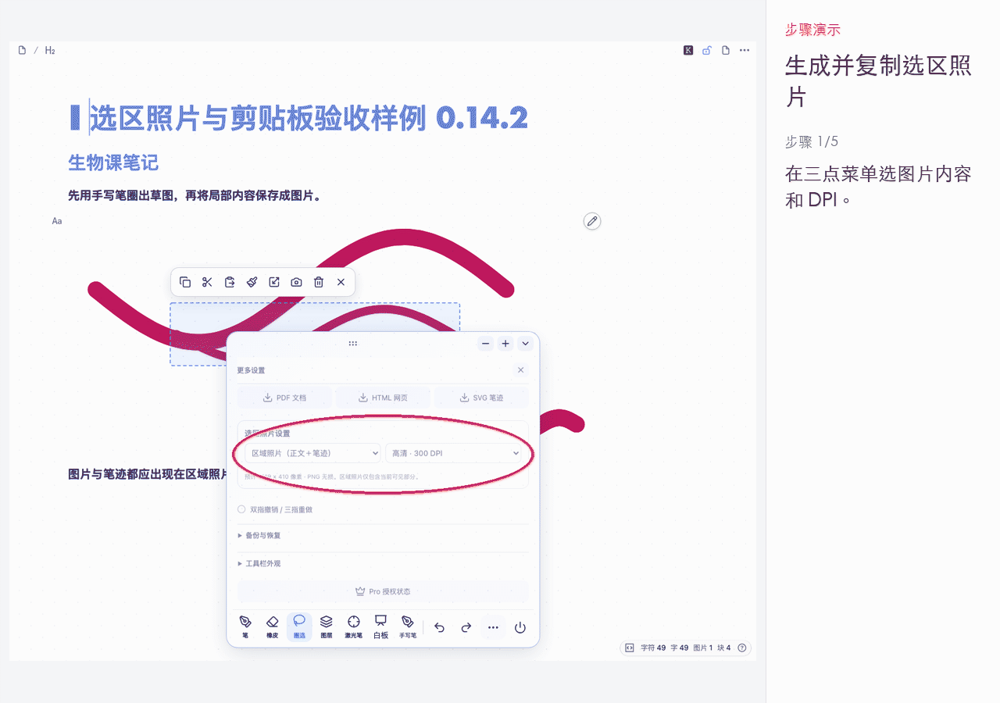
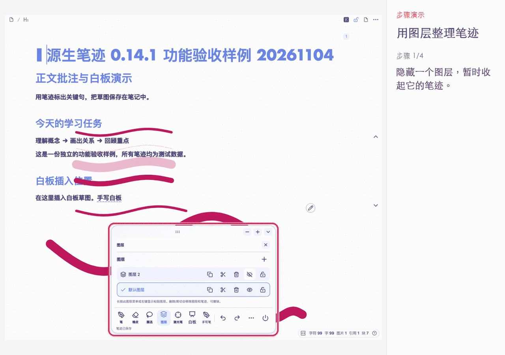
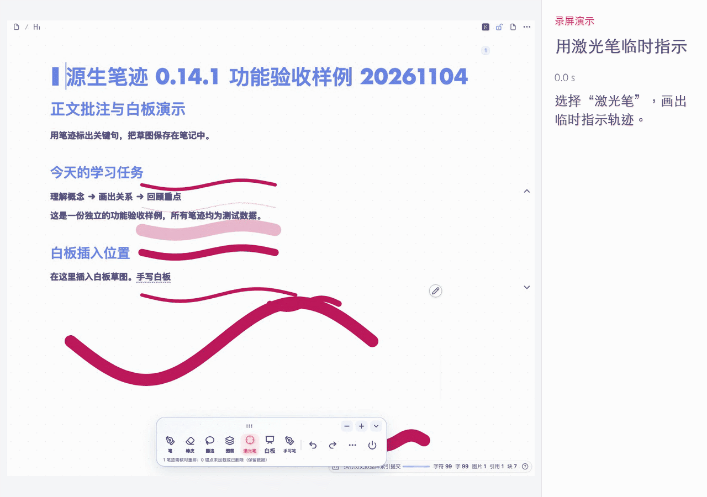

# 源生笔迹 ✍️

我的初中老师曾告诉我：**No pencil, No reading.**

我始终认为，只有真正拿起一支笔，才能沉下心来读一读、想一想。无论是阅读时随手写下的批注，还是灵光一闪时记录的想法，笔尖划过纸面的过程，本身就是思考的一部分。

步入 AI 时代，我们拥有了越来越多强大的数字化工具，但我依然希望保留这种最朴素的习惯：手握一支笔，在思源笔记中自由地阅读、批注、记录与思考。

**当前版本 0.14.16** · 适用于思源笔记 **3.8.4 及以上版本** · [下载安装包](https://github.com/jiangeeeeee/siyuan-native-handwriting/releases/download/v0.14.16/package.zip)

## 🌟 这一版，可以直接在 PDF 上读写了

下面这份实验手册讲的是回声测距。发出声音，过了 0.20 秒听到回声，墙离我们多远？拿这道小题试一遍，就能走通从读 PDF 到整理笔记的全过程。

| 想做什么 | 从哪里开始 |
| --- | --- |
| 把手册放进笔记 | 正文工具栏 → 插入 PDF |
| 看清公式，再画一笔 | 在 PDF 页上双指张开或捏合 |
| 把公式和批注留在正文 | 圈选摘录 → 引用到当前文档 |
| 分享带批注的文件 | PDF 工具栏 → 导出批注副本 |
| 画角度、流程框或电路 | 插入图形 → 量具、流程或电路 |
| 换颜色、调笔宽 | 笔 → 色卡与参数滑块 |

### 📎 把 PDF 放进笔记，打开就能写

在接收资料的那篇笔记里点 **「插入 PDF」**，从设备选文件。思源会把它保存为附件，链接留在这篇笔记里，阅读器随即打开。沿用正文里选好的红笔，直接给距离公式画一道下划线。桌面阅读器里可以点「PDF 手写」展开工具栏。

### 🔍 两指放大，看看分母里的 2

把两指放在公式两边，向外张开。字变大，刚画的红线也跟着字一起放大。看明白了再捏合，便能看到上下文。动图里的两个圆点标出手指的位置。

### 📌 圈下公式，把它带回正文

点 **「圈选摘录」**，用笔把公式和下划线一起围住，再点 **「引用到当前文档」**。回到正文，就能在摘录下面写自己的解释，比如「回声走了一个来回，所以距离要除以二」。下次点摘录里的页码，思源会重新打开对应位置。扫描件也能截取图像，文字摘录需要 PDF 本身带有文字层。

### 📖 翻到实验步骤，再翻回来

在页码框输入 **3**，跳到第三页看怎样读出回声间隔。插件只在当前视野和邻近页面准备手写层。回到第一页，之前的红线会重新出现在公式下。想继续写笔记，点手写工具栏上的关闭按钮就能回到正文。

### 📤 把批注发给别人

在 PDF 工具栏点 **「导出批注副本」**。导出的 PDF 已经带上红线，对方用普通 PDF 阅读器也能看。动图最后把两份文件的同一处公式放到一起，可以看到原始附件仍是干净的。

### 📐 在笔记里量一个角

打开 **「插入图形 → 量具 → 三点测角」**。第一点落在一条边上，第二点落在角的顶点，第三点落在另一条边上，角度就标出来了。同一个面板里还有直尺、圆规和直角坐标系，适合画辅助线、圆弧和坐标草图。

### ➜ 把两个模块连成流程图

在 **「流程」** 里选矩形模块，连续拖出两个框，再换成连接箭头，从左框边缘拖向右框。画一道判断分支时，可以把模块换成菱形；需要说明每一步时，图库里也有文本标签。

### ⚡ 从图库取一个电阻

在 **「电路」** 里选电阻，从想放置的位置拖出符号。点选已有图形，还可以拖动控制点调整大小。图库中也有电容、电感、二极管、开关、接地和导线，画电路草稿时可以逐个补上。

### 🎨 给下一笔换个手感

工具栏的 **「书写方式」** 显示当前用笔还是用手指。点 **「笔」**，上半部选颜色，也能把自己调好的颜色存进色卡；下半部调压感、稳定性、粗细和透明度。想让批注轻一点，先调透明度；想让下划线细一点，就调粗细。

## ✍️ 平时怎么用

### 在段落旁留一笔

点正文面包屑或顶栏的手写笔，就能在原文上圈画。划在公式下面的线、写在图片旁的小注，都按所附内容定位。收起左侧文档树或改变窗格宽度时，笔迹会跟着内容重新排好。

### 一句话用马克笔，一行推导用钢笔

钢笔适合写小字，马克笔适合扫过一行重点。面板里还有铅笔和彩笔。每种笔可以选自己的常用色，换回原来的笔型，接着写就好。

**擦错了一点？** 用精确擦除修掉多出来的线头，或切到笔画擦除，整笔拿掉。擦多了，点撤销找回来。

### 把写好的批注挪一挪

点「圈选」，用套索围住一组笔迹，或用矩形框选。按住选框内部拖动，就能把一组批注移到合适的位置。

**同一个符号还要再用？** 选中后复制、粘贴，再调大小。整理图例时，也能把同类标记统一换色。

**只想分享这一小块？** 点选框旁的相机，把笔迹连同下面的原文截成一张图；也可以只取透明背景的笔迹。预览后复制，直接贴进讲义或消息里。

### 📝 一张白板，专门留给草稿

正文边上写不下时，点「白板」换一块空地方。可以铺方格推公式，放大写下一步，再点「全览」看整张草图。一篇笔记能放多张白板，草稿和定稿也可以分开画。

**把草稿放回笔记。** 先在正文点好插入位置，再进白板画图。点「插入正文」，预览图就落在刚才的位置。开启白板双链后，还能从正文回到对应白板继续编辑。

### 讲题时，分层写、临时指

**图层**适合把题干标记和解题过程分开。讲第二种解法时，先隐藏第一种；已经画好的底图也可以锁住。

**激光笔**适合指给别人看。沿信号方向划过去，轨迹会自行淡出，讲完还能看到原来的图。

### 让鼠标选字，让数位笔写字

数位板和鼠标一起用时，在「⋯」里取消勾选「鼠标参与手写」。这样笔可以继续批注，鼠标可以拖选文字或放置光标。要用鼠标画图，再勾回来。

### 让工具栏适合自己的桌面

长按手柄可挪动工具栏，在「⋯」里可以调整大小和背景透明度。正文、白板和 PDF 共用外观设置。喜欢手边一直留着几支笔，可以把工具栏停靠在角落，给正文腾出位置。

**换一套外观。** 喜欢浅色或深色界面，可以在「工具栏外观」里挑一套主题。

主题强调色也能自己调。在色盘里选颜色，或使用存好的色卡，为常用按钮换个配色。

### 🗂 给笔迹留一份备份

打开「⋯ → 备份与恢复」，可以批量备份，也可以展开「高级：单篇笔迹数据」，单独导出当前笔记的 JSON。以后要继续编辑笔迹，就从同一处恢复。要发给别人阅读，可从文档导出菜单选择带笔迹的 PDF、HTML，或单独导出 SVG 笔迹。

## 🕰 版本记录

| 版本 | 更新 |
| --- | --- |
| 0.14.16 | 新增 PDF 手写、双指缩放、摘录引用和批注副本，加入工程图形与平板画笔面板。 |
| 0.14.15 | 修复白板上闪动的正文光标，以及侧栏伸缩后公式、图片附近的笔迹漂移。 |
| 0.14.14 | 增加悬停笔尖样式，把白板操作收进工具栏，合并重复的同步提示。 |
| 0.14.13 | 支持跨段落留白连续落笔，修复工具快捷键，调整激光笔和笔鼠切换。 |
| 0.14.12 | 白板支持粘贴图片，记住工具偏好，修复快捷键切换。 |
| 0.14.11 | 数位笔和鼠标可分工操作，修复抬笔误点图片和笔迹撤销问题。 |
| 0.14.10 | 增加矩形框选和白板底纹，改进连续书写与白板手势。 |
| 0.14.9 | 手写入口移到正文面包屑，减少连续落笔时的索引更新。 |
| 0.14.8 | 支持一篇笔记使用多张白板，降低正文笔迹的内存占用。 |
| 0.14.7 | 缩短连续书写和擦除密集笔迹时的等待。 |
| 0.14.6 | 长文档优先绘制可见笔迹，改善第一笔的响应。 |
| 0.14.5 | 合并同一文档的笔迹同步文件，备份只更新有改动的文档。 |
| 0.14.4 | 修复触屏擦除后切回画笔的问题，调整橡皮按钮的悬停效果。 |
| 0.9.1 | 提供正文批注、白板、钢笔、马克笔、橡皮、撤销重做和笔迹备份。 |

[使用指南](docs/使用指南.md) · [许可条款](LICENSE) · [第三方组件声明](THIRD_PARTY_NOTICES.md)
