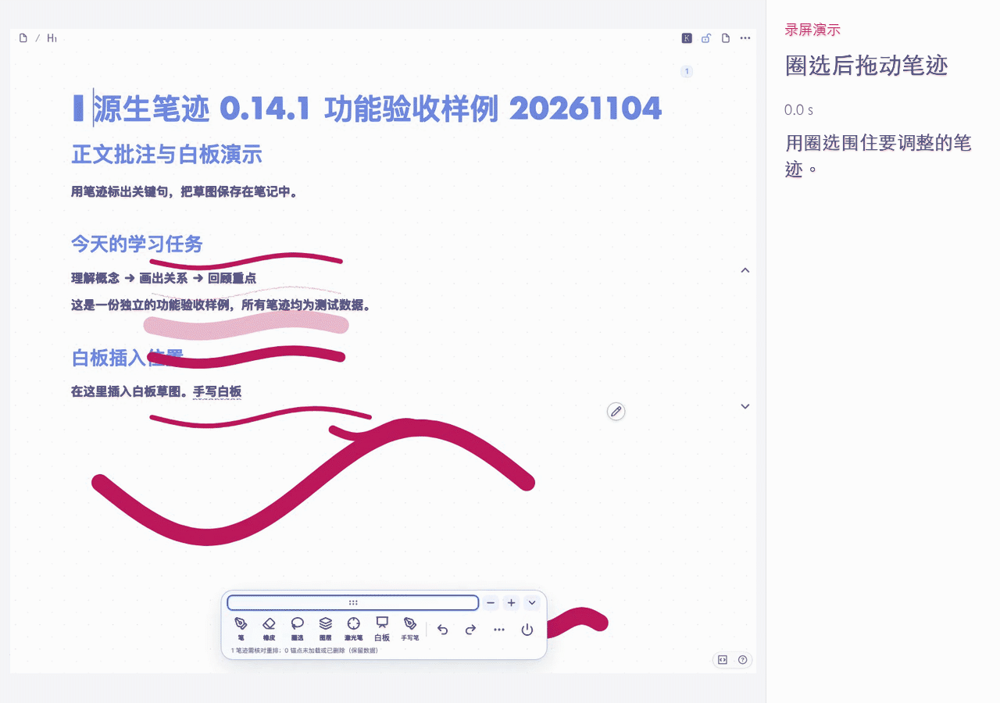

# ✍️ 源生笔迹｜让笔迹留在知识里

**No pencil, No reading.**

当前版本 **0.14.9** · 适用于思源笔记 **3.8.4 及以上版本**。

源生笔迹是一款专为思源笔记打造的手写插件。无需离开正在阅读的文档，就能随时拿起笔，圈画重点、手写批注，也可以打开自由白板，记录灵感与推导。

键盘负责整理，笔迹负责思考。让两种记录方式自然地融合在一起。

---

## 📝 正文手写｜在阅读的地方留下笔迹

读论文时圈出关键结论，做习题时写下解题思路，整理资料时随手添加批注。

不必将图片导出到其他软件，也不用在笔记和手写应用之间来回切换。直接在思源正文中书写，笔迹跟随内容保存，之后仍可继续修改。

## 🎨 自由白板｜想画就画，想写就写

遇到需要画图、推导公式或梳理思路的时候，打开自由白板，便拥有一块不受正文排版限制的书写空间。

支持自由缩放、平移与多白板管理。Pro 功能还可以将白板插入正文，建立双向链接，让手绘内容成为知识体系的一部分。

## 🖊️ 丰富的笔刷｜找回纸笔书写的手感

钢笔、马克笔、彩笔等多种书写工具，支持调整颜色、粗细，并适配手写设备的压感。

无论是细致的文字批注，还是随手勾画的示意图，都能找到合适的书写方式。

Pro 还提供铅笔、图层管理和激光笔等工具，让书写更加自由。

## ✂️ 灵活编辑｜写完也能随时调整

写错了可以擦除，位置不合适可以圈选移动，还能撤销、重做，让笔迹不再受纸张限制。

阅读时不用担心一次写得不够完美。想补充、想修改，随时回来继续。

## 🔗 白板双链｜让手绘内容融入笔记

白板不必孤零零地待在画布里。

通过 Pro 的白板关联功能，可以把手写内容插入思源正文，并在白板与笔记之间建立联系。

课堂推导、知识框架和随手画下的草图，都能回到对应的知识位置。

## 📦 安装与使用

前往 [GitHub Releases](https://github.com/jiangeeeeee/siyuan-native-handwriting/releases/latest) 下载最新版本，也可以在思源插件集市中搜索「源生笔迹」安装。

启用插件后，点击正文面包屑或顶栏的手写笔图标，即可开始正文批注，也可以从手写工具栏打开白板。

[使用指南](docs/使用指南.md) · [全部功能动图](docs/动图索引.md) · [当前版本测试报告](docs/0.14.9-面包屑与性能测试报告.md)

## Pro 购买与激活

笔迹 Pro 授权码可在淘宝[铛铛学长的小店](https://m.tb.cn/h.jSTvJj45DK7IVMR)购买，价格为 **¥29.9／永久**。

1. 打开插件授权窗口，复制「当前思源账号 ID」。
2. 购买后将该 ID 发给店铺客服，取得对应的 HW1 授权码。
3. 在授权窗口粘贴完整授权码，点击「激活 Pro」。

授权绑定思源账号，同一账号可在多台设备使用相同授权码。0.14.9 在本机完成签名校验，用户无需安装或部署授权服务器。订单确认和发码由客服完成。

## 许可说明

本项目自有部分适用[商业使用许可](LICENSE)，并授权思源官方集市分发完整安装包。

[第三方组件](THIRD_PARTY_NOTICES.md)继续适用各自的原许可证。

---

**让笔迹留在知识里，让思考不止于键盘。**
