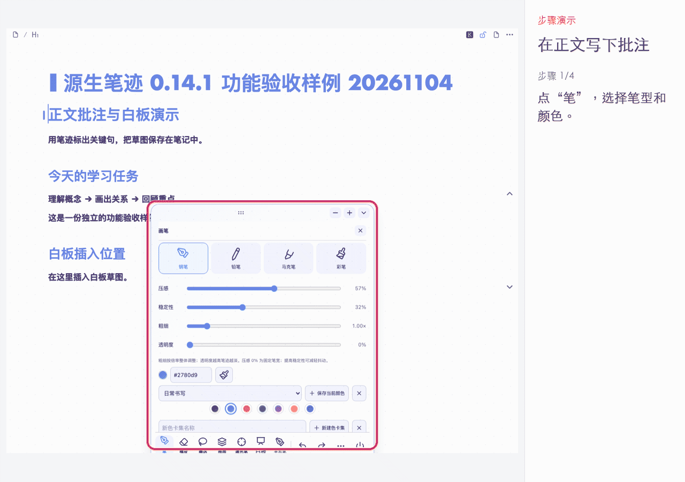
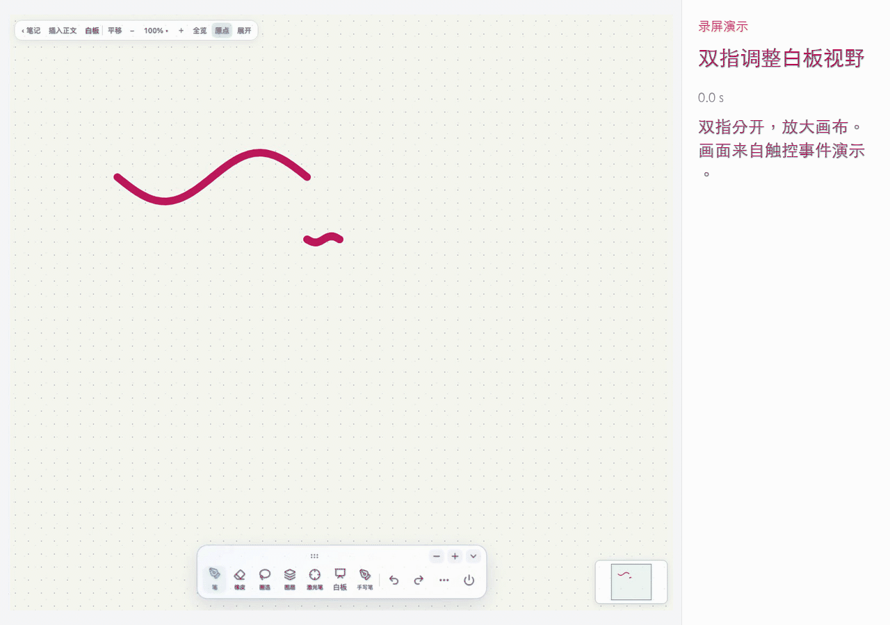
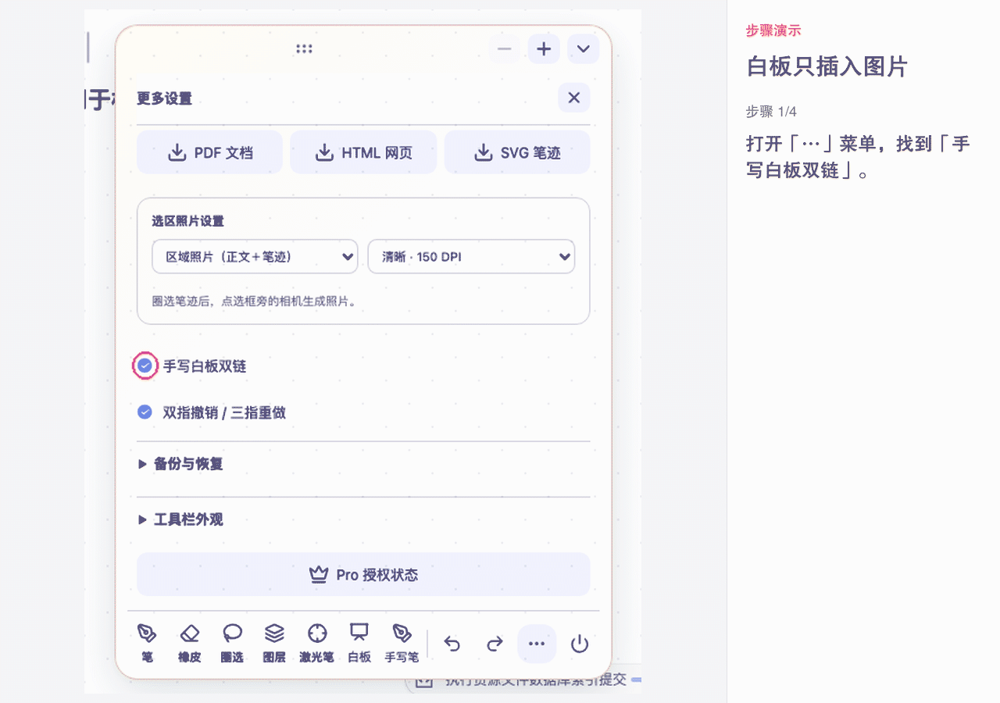

# ✍️ 源生笔迹｜让笔迹留在知识里

## 0.14.15 更新

修复打开白板后正文输入光标仍会闪动的问题。白板打开时，键盘输入不会写入下层笔记。返回笔记后可继续编辑，插入白板时仍使用打开白板前选定的位置。

## 0.14.14 更新

- 工具栏拖到顶部时会停在文档标签栏下沿，长按手柄可移动工具栏，标签仍可正常切换。

- 数位笔接近书写区域时显示十字。打开手写工具栏的「… → 笔尖指针」，可换成空心圆或圆点。正文与白板共用该设置，移动鼠标时恢复鼠标指针。
- 点击「白板」进入画布，缩放、背景、图片、新建白板和返回笔记都在同一工具栏内。点击「笔」可选笔和颜色，再点「白板」可展开白板操作。
- 重复的同步失败提示合并显示，保留最新错误详情。思源弹窗打开时暂时隐藏笔迹覆盖层，关闭后恢复。

## 0.14.13 更新：连续落笔、快捷键与激光笔

- 正文块之间、段落外侧的留白可以连续书写。笔迹仍随附近正文块保存，抬笔不会截断越过块边界的线条。
- 快捷键读取思源当前设置，支持 Ctrl 组合和同一命令的多个绑定。新增「开启／关闭手写」，书写和白板中均可切换工具；绑定重复时会提示到快捷键设置中修改。
- 激光笔可选择抬笔后立即淡出，或保留 1、3、5、10 秒，默认 3 秒。选色改用完整色卡，支持自定义颜色、HEX 和色盘。
- 数位笔进入书写区域时隐藏页面指针与正文光标，鼠标移动后恢复。连续落笔不再反复设置同一个焦点。
- 关闭「鼠标参与手写」后，鼠标仍可使用套索、矩形框选；画笔和橡皮保持只接收笔输入。

### 快捷键与笔鼠配合

在思源「设置 → 快捷键」中搜索「源生笔迹」，可以修改以下按键。macOS 将 Alt 换成 Option；Ctrl 指 Control 键。

| 操作 | 默认快捷键 |
| --- | --- |
| 开启／关闭手写 | Ctrl+Shift+H |
| 画笔 | Alt+Shift+P |
| 橡皮 | Alt+Shift+E |
| 圈选 | Alt+Shift+L |
| 返回正文编辑 | Alt+Shift+T |

数位板与鼠标并用时，在「…」中取消勾选「鼠标参与手写」。选择画笔或橡皮时，鼠标用于选中正文、定位文字光标；选择圈选时，鼠标用于选取、移动笔迹。驱动需将数位笔上报为独立的笔输入。

## 0.14.12 更新：工具偏好、快捷键与白板图片

- 修复快捷键从圈选切换到橡皮时，仍弹出套索选项的问题，工具和选项面板保持一致。
- 修复手写或白板接管焦点后工具快捷键失效的问题，沿用思源快捷键设置中的自定义按键。默认 Alt+Shift+P／E／L／T 分别选择画笔、橡皮、圈选和正文编辑；macOS 使用 Option+Shift。
- 橡皮模式、直径和擦除范围保存为共享偏好，切换笔记、白板或重启后继续使用。套索／矩形框选的选择也会保留。
- 白板新增「粘贴图片」「导入图片」和「调整图片」。支持 PNG、JPEG；可移动、等比缩放、删除及撤销重做，图片随白板保存，插入正文时与笔迹一起生成预览。

### 在白板上粘贴图片

复制图片后，在白板中按 Ctrl+V（macOS：Command+V），也可点击「粘贴图片」。若系统不允许读取剪贴板，可用「导入图片」选择文件。粘贴后拖动图片调整位置，拖动右下角调整大小，点击「完成图片调整」或切回画笔即可在图上书写。

单张图片不超过 20 MB，导入时将长边缩至最多 1600 像素；同一图片复用存储文件，离开可视区域后释放显示缓存。图片文件保存在思源工作空间的 `data/storage/petal/siyuan-native-handwriting/images/`，与白板记录一起随工作空间同步；手动迁移时请保留整个插件数据目录。

## 0.14.11 补充修复：落笔、图片和键盘操作

- 提前接收数位笔事件，避免正文块的事件处理抢走落笔。抬笔后拦截派生的鼠标点击、双击和拖拽，防止书写时打开图片。
- Ctrl+Z／macOS 的 Command+Z 根据正文状态选择笔迹撤销或思源正文撤销。Ctrl+Shift+Z／Command+Shift+Z 可重做。笔迹操作前先提交待处理的正文输入。
- 工具快捷键接入思源快捷键设置。默认 Alt+Shift+P 选择画笔，Alt+Shift+E 选择橡皮，Alt+Shift+L 选择圈选，Alt+Shift+T 返回正文编辑。macOS 使用 Option+Shift。
- 数位板与鼠标并用时，在「…」中取消勾选「鼠标参与手写」，鼠标即可选择正文、定位光标。

该修复已包含在当前版本中。

## 0.14.11 更新：鼠标与数位笔输入

- 在手写工具栏的「…」中增加「鼠标参与手写」。关闭后，数位笔仍可书写，鼠标可选择段落、定位光标，键盘可输入正文。
- 修复手写开启时拦截正文鼠标点击的问题。当前该开关适用于画笔、橡皮和激光笔；圈选可独立使用鼠标。
- 修复编辑区自身为正文容器时，段落空白处无法找到笔迹附着块的问题。
- 鼠标编辑模式下关闭桌面的兼容覆盖层，正文可直接接收鼠标操作。

### 数位板与鼠标同时使用

打开手写工具栏的「…」，点击「鼠标参与手写」，**取消勾选**即可。画笔保持选中时，数位笔用于书写，鼠标用于选择段落、定位光标，键盘也可以正常输入文字。

需要用鼠标画图时，再次勾选「鼠标参与手写」。

首次安装默认勾选此项，已有用户需要手动取消勾选一次，设置会自动保存。数位板驱动需要将笔上报为独立的笔输入；若驱动把笔和鼠标都识别成鼠标，请开启此项以恢复数位板书写。

**No pencil, No reading.**

当前版本 **0.14.15** · 适用于思源笔记 **3.8.4 及以上版本**。

源生笔迹是一款专为思源笔记打造的手写插件。无需离开正在阅读的文档，就能随时拿起笔，圈画重点、手写批注，也可以打开自由白板，记录灵感与推导。

键盘负责整理，笔迹负责思考。让两种记录方式自然地融合在一起。

## 0.14.10 更新：连续书写与白板操作

- 连续书写时暂停后台整页编码和同步合并，停笔后分段继续。统计撤销记录和显示缓存时直接读取压缩笔迹的点数，减少旧笔迹反复展开产生的临时对象。
- 白板支持双指轻点撤销、三指轻点重做；双指移动仍用于平移、缩放。在「…」中开启多指撤销与重做后使用。
- 圈选可切换「套索」和「矩形框选」。粘贴与取消选择合并在同一行，复制或剪切后才显示粘贴。
- 白板新增背景菜单：8 种标准底色、自定义颜色，以及纯色、点状、横线、方格底纹。每张白板分别保存，插入正文的图片保留背景。
- 更新手写入口、白板、激光笔和截图图标；工具栏新增「松绿」「雾蓝」主题，小屏幕按钮排列更整齐。

---

## 📝 正文手写｜在阅读的地方留下笔迹

读论文时圈出关键结论，做习题时写下解题思路，整理资料时随手添加批注。

不必将图片导出到其他软件，也不用在笔记和手写应用之间来回切换。直接在思源正文中书写，笔迹跟随内容保存，之后仍可继续修改。

## 🎨 自由白板｜想画就画，想写就写

遇到需要画图、推导公式或梳理思路的时候，打开自由白板，便拥有一块不受正文排版限制的书写空间。

支持自由缩放、平移与多白板管理，每张白板可单独设置底色和点状、横线、方格底纹。Pro 功能还可以将白板插入正文，建立双向链接，让手绘内容成为知识体系的一部分。

## 🖊️ 丰富的笔刷｜找回纸笔书写的手感

钢笔、马克笔、彩笔等多种书写工具，支持调整颜色、粗细，并适配手写设备的压感。

无论是细致的文字批注，还是随手勾画的示意图，都能找到合适的书写方式。

Pro 还提供铅笔、图层管理和激光笔等工具，让书写更加自由。

## ✂️ 灵活编辑｜写完也能随时调整

写错了可以擦除，位置不合适可用套索或矩形框选后移动，也可以撤销、重做。粘贴与取消选择位于同一行，复制或剪切后才显示。

阅读时不用担心一次写得不够完美。想补充、想修改，随时回来继续。

## 🔗 白板双链｜让手绘内容融入笔记

白板不必孤零零地待在画布里。

通过 Pro 的白板关联功能，可以把手写内容插入思源正文，并在白板与笔记之间建立联系。

课堂推导、知识框架和随手画下的草图，都能回到对应的知识位置。

## 📦 安装与使用

前往 [GitHub Releases](https://github.com/jiangeeeeee/siyuan-native-handwriting/releases/latest) 下载最新版本，也可以在思源插件集市中搜索「源生笔迹」安装。

启用插件后，点击正文面包屑或顶栏的手写笔图标，即可开始正文批注，也可以从手写工具栏打开白板。

[使用指南](docs/使用指南.md) · [全部功能动图](docs/动图索引.md) · [当前版本测试报告](docs/0.14.10-连续书写与白板测试报告.md)

## 许可说明

本项目自有部分适用[商业使用许可](LICENSE)，并授权思源官方集市分发完整安装包。

[第三方组件](THIRD_PARTY_NOTICES.md)继续适用各自的原许可证。

---

**让笔迹留在知识里，让思考不止于键盘。**
