# 源生笔迹 ✍️

我的初中老师曾告诉我：**No pencil, No reading.**

读到一个公式，我习惯先圈出关键的一项，在旁边写下自己的疑问。源生笔迹把这个习惯带进了思源笔记。正文可以随手划，PDF 可以边读边批，纸面不够就开张白板。

**当前版本 0.15.0** · 适用于思源笔记 **3.8.4 及以上** · [下载安装包](https://github.com/jiangeeeeee/siyuan-native-handwriting/releases/download/v0.15.0/package.zip)

## 🌟 0.15.0 新在哪里

### ✍️ 在段落间落笔，在长 PDF 上接着写

给两段推导补一个箭头，起笔的位置常常正好落在空白处。现在，连续在段落间写字时，插件会复用刚量过的正文位置。侧栏收起、字体变化或正文重排后，再重新定位。读长 PDF 时，翻页也不会让插件在下一次抬笔时重新遍历整份阅读器。

| 实际操作 | 0.14.16 | 0.15.0 |
| --- | ---: | ---: |
| 900 个段落，段落间落笔到提交第一笔墨迹 | 1.2 ms | **0.4 ms** |
| 240 页 PDF，翻页后落笔到提交第一笔墨迹 | 0.5 ms | **0.2 ms** |
| 同一份 PDF，抬笔事件处理完毕 | 2.4 ms | **0.1 ms** |

在同一台 Mac 上，用 Chromium 重放相同的笔输入。正文取 60 笔的中位数。PDF 约 15.2 MiB，在思源 3.8.11 中往返第 1 页和第 120 页，取 30 笔的中位数。首笔计时到浏览器提交绘制为止，笔尖接触屏幕到像素亮起还包含设备采样和屏幕刷新时间。

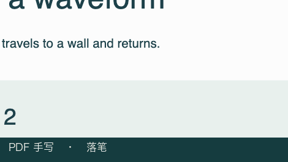

### 📖 两种翻 PDF 的办法

| 手头的线索 | 怎么翻 |
| --- | --- |
| 记得章节名 | 在手写工具栏点「阅读导航」→「大纲」，点章节或小节标题，直接跳到原页。 |
| 只记得那页长什么样 | 切到「缩略图」，沿着小图找熟悉的公式或版式，点一下就能在大页上接着写。没有内置大纲的 PDF 也能这样翻。 |

#### 按大纲跳到章节

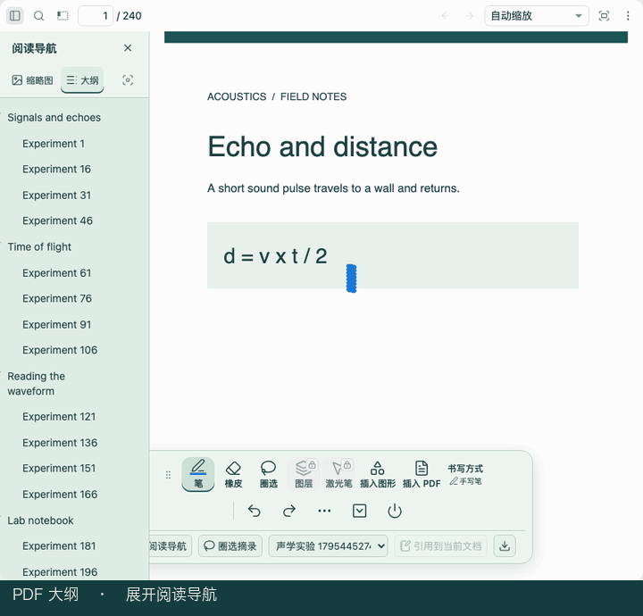

#### 按缩略图挑页面

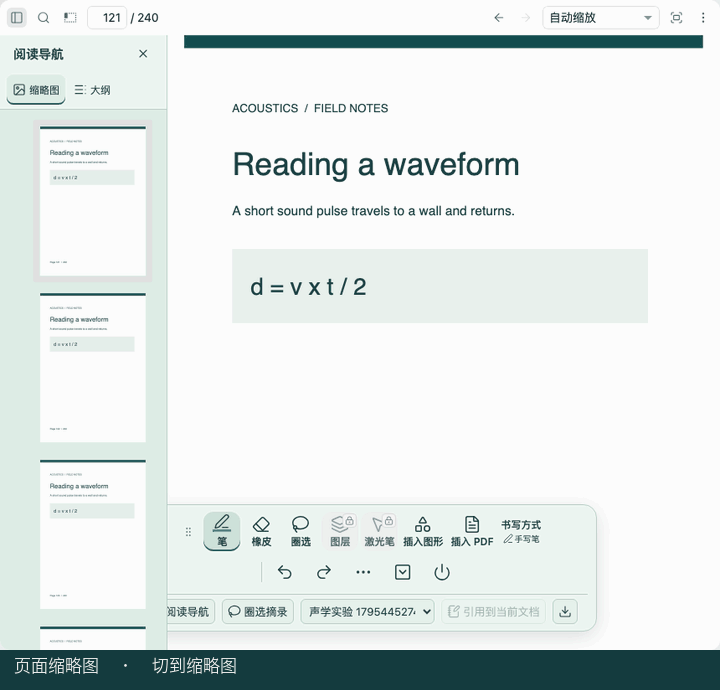

### 🎨 给工具栏换个颜色

| 想怎么调 | 在哪里调 |
| --- | --- |
| 换整套外观 | 打开「更多」→「工具栏外观」。新加了亚麻纸、海盐蓝、夜松、陶土、石墨、青瓷六套。喜欢暖纸色可以试试亚麻纸，夜间阅读可以试试夜松。 |
| 只换强调色 | 在「主题强调色」里选色或输入十六进制色值。正文、白板和 PDF 共用这项设置，原有笔迹保留自己的墨色。点「恢复主题配色」就能找回所选主题的默认色。 |

#### 六套新外观

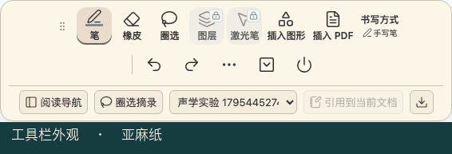

#### 自己选强调色

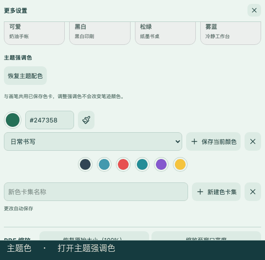

## ✍️ 已有功能

### 读 PDF，手边就有一支笔

拿回声测距做个小练习。听到回声用了 0.20 秒，怎么从这段时间算出墙有多远？先圈一下公式，再把它摘回笔记。

| 功能 | 怎么用 |
| --- | --- |
| [插入 PDF 并批注](#插入-pdf-并批注) | 在正文点「插入 PDF」选文件。附件会自动打开，链接留在笔记里，选好的画笔可以接着用。桌面端点「PDF 手写」展开工具栏。 |
| [双指缩放](#双指缩放) | 在公式两侧张开手指放大，捏合缩小。刚画的下划线会跟着原文。 |
| [圈选摘录](#圈选摘录) | 用「圈选摘录」围住公式和批注，再点「引用到当前文档」。点摘录里的页码可跳回原处。扫描件也能截取图像。 |
| [翻页找回批注](#翻页找回批注) | 在页码框跳到实验步骤，再回第一页。插件按需准备当前页和邻近页的手写层，翻回去就能看到原来的线。点关闭按钮可回到笔记。 |
| [导出批注副本](#导出批注副本) | 点「导出批注副本」，把带批注的 PDF 发给同学。原始附件保留原样。 |

#### 插入 PDF 并批注

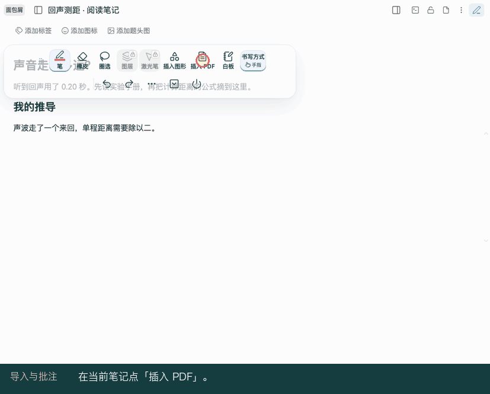

#### 双指缩放

#### 圈选摘录

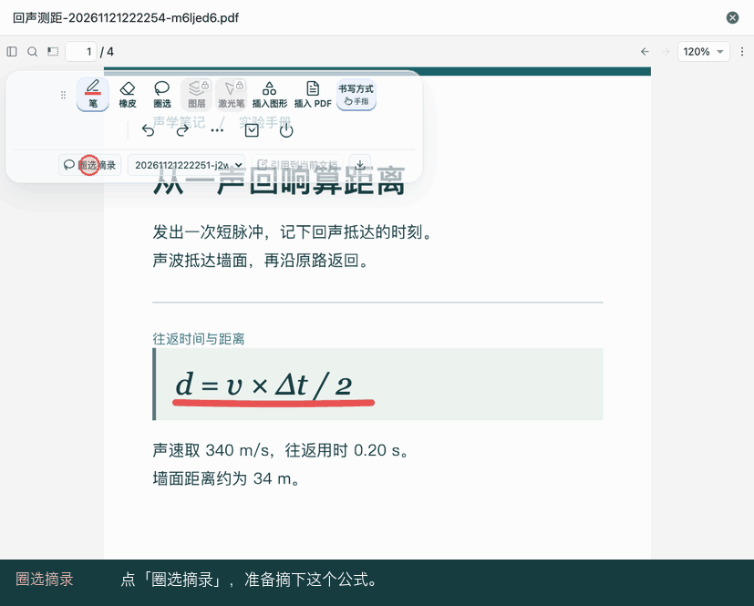

#### 翻页找回批注

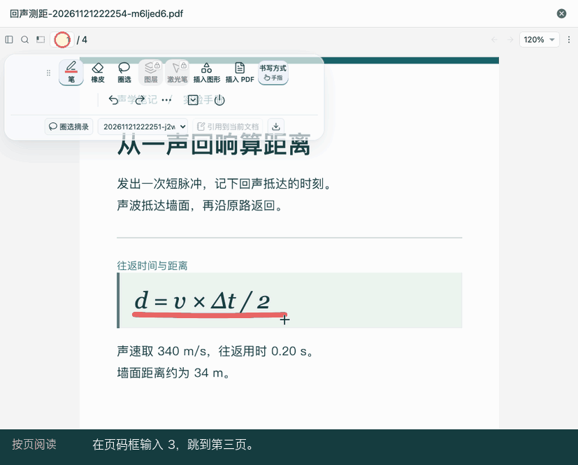

#### 导出批注副本

### 📐 用量具画题图

打开「插入图形」，点「几何」或「量具」。推导做到一半要补一条线，直接在笔记边上画。

| 功能 | 怎么用 |
| --- | --- |
| [折线](#折线) | 依次点出转折位置，点「完成」。要改走势，再拖动相应的控制点。 |
| [直尺](#直尺) | 拖出尺身，点「沿尺画线」。线会贴着尺边，移走尺子后仍留在原处。 |
| [圆规](#圆规) | 选「圆规画圆」或「圆规画弧」，从圆心向外拖，定好半径。 |
| [三点测角](#三点测角) | 先点一条边，再点顶点，最后点另一条边。夹角直接标在图上。 |
| [直角坐标系](#直角坐标系) | 拖出坐标范围，横纵轴和网格会一起出现。接下来可以描点或画曲线。 |

#### 折线

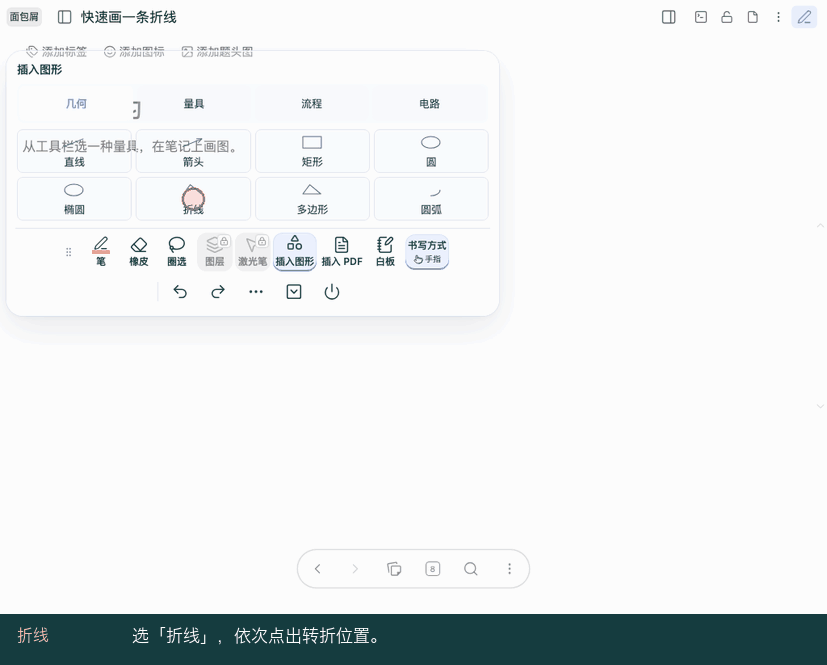

#### 直尺

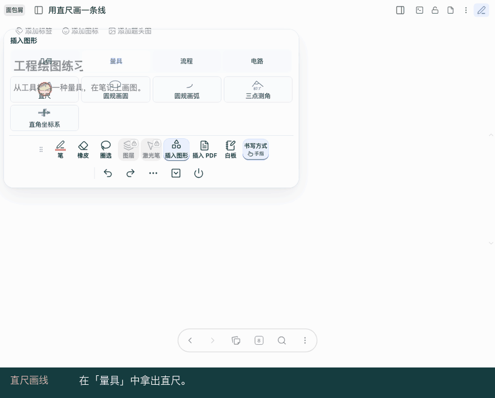

#### 圆规

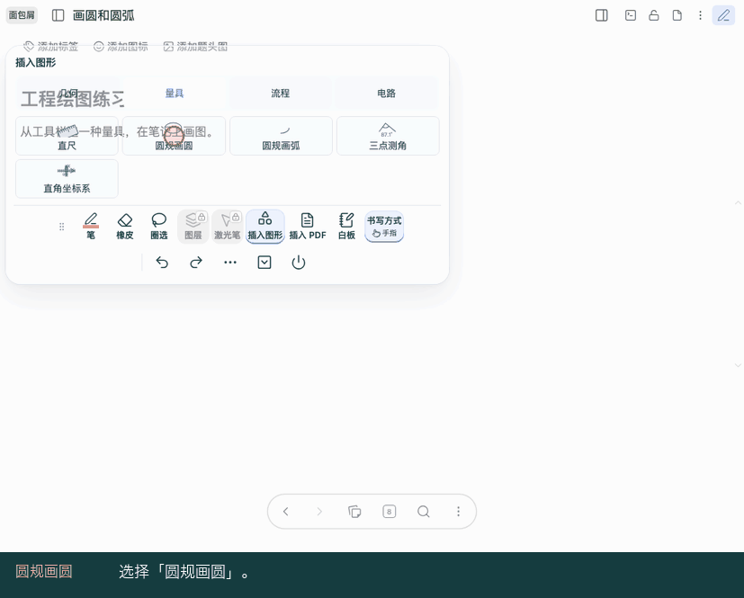

#### 三点测角

#### 直角坐标系

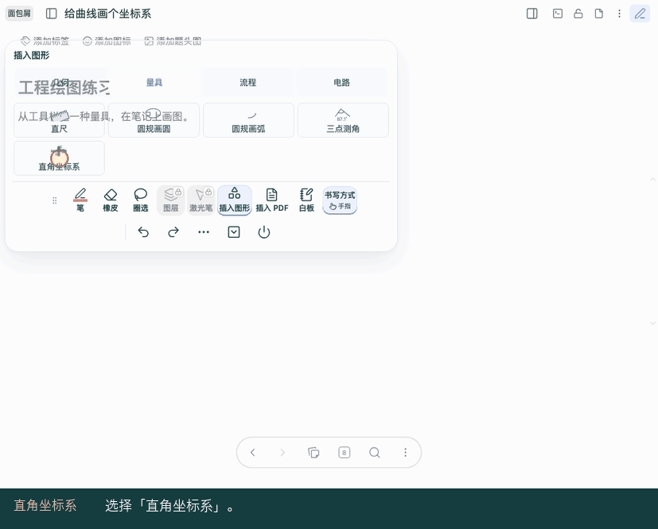

### ⚡ 搭流程，画电路

| 功能 | 怎么用 |
| --- | --- |
| [流程框图](#流程框图) | 在「流程」里连续拖出两个模块，再用连接箭头从一个框连到另一个框。碰到判断分支时，换成菱形。 |
| [电路符号](#电路符号) | 在「电路」里选电阻、电容或电感，拖出元件。点中已有元件后，可用控制点调整大小。 |

#### 流程框图

#### 电路符号

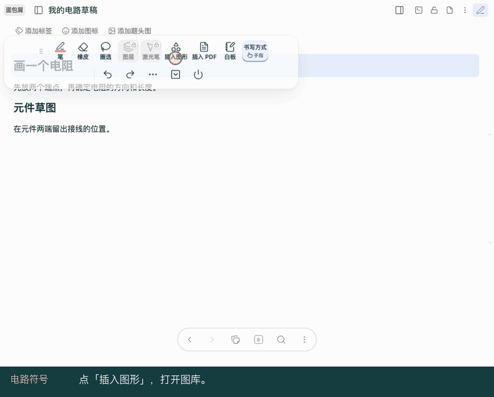

### 🎨 调好手里的笔

| 功能 | 怎么用 |
| --- | --- |
| 平板画笔面板 | 点「书写方式」切换手写笔和手指。点「笔」换颜色，或拖滑块调压感、稳定性、粗细和透明度。调出的颜色也能存进色卡。 |

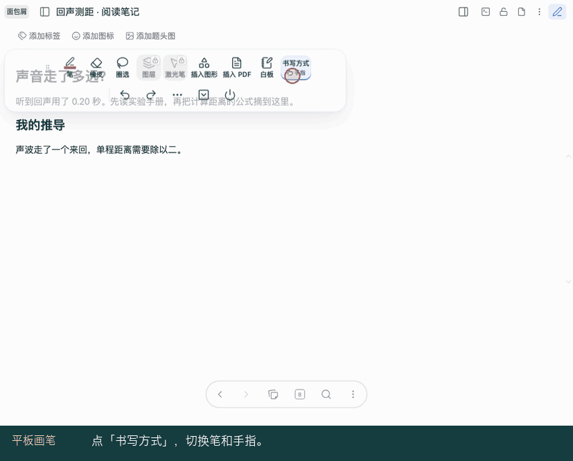

### 写在正文里

| 功能 | 怎么用 |
| --- | --- |
| [正文批注](#正文批注) | 点面包屑或顶栏的手写笔，在段落旁圈重点。移动段落或收起文档树时，笔迹随所附内容重新定位。 |
| [切换画笔](#切换画笔) | 用钢笔写小字，用马克笔扫过一行。也可以切到铅笔或彩笔，颜色可随笔型记住。 |
| [橡皮与撤销](#橡皮与撤销) | 精确擦除可以修掉一小截，笔画擦除可以去掉整笔。擦多了就点撤销。 |
| [数位笔和鼠标分工](#数位笔和鼠标分工) | 在「⋯」取消勾选「鼠标参与手写」。用数位笔写，用鼠标选字。 |

#### 正文批注

#### 切换画笔

#### 橡皮与撤销

#### 数位笔和鼠标分工

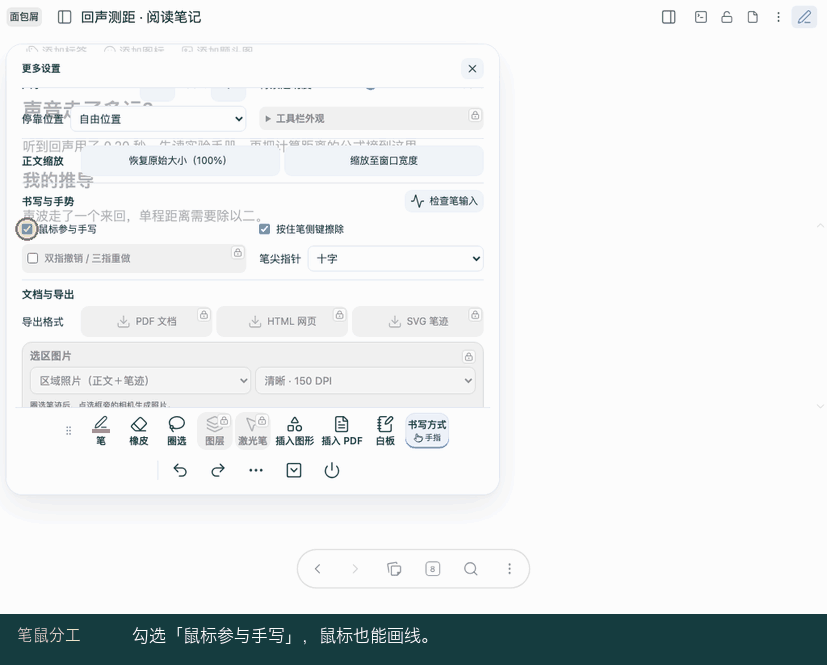

### 整理写好的笔迹

| 功能 | 怎么用 |
| --- | --- |
| [圈选与移动](#圈选与移动) | 用套索或矩形框住几笔，拖着选框把它们挪到空一点的地方。 |
| [复制、缩放与换色](#复制缩放与换色) | 把常用标记复制一份，再调大小或换色。 |
| [选区照片](#选区照片) | 点选框旁的相机，把批注和下面的原文保存成图片。只要笔迹时，可以选透明背景。 |
| [图层](#图层) | 把题干标记和解法分层。讲第二种解法时，先藏起第一层。 |
| [激光笔](#激光笔) | 画一条临时轨迹指给别人看。讲完后轨迹自行淡出。 |

#### 圈选与移动

#### 复制、缩放与换色

#### 选区照片

#### 图层

#### 激光笔

### 📝 白板、工具栏与备份

| 功能 | 怎么用 |
| --- | --- |
| [自由白板](#自由白板) | 开张白板铺方格，写不下就缩放或平移。草稿和定稿可以各用一张。 |
| [白板插回正文](#白板插回正文) | 在正文选好位置，从白板点「插入正文」。开启白板双链后还能从预览返回草图。 |
| [工具栏位置与透明度](#工具栏位置与透明度) | 长按手柄挪位置，在「⋯」调大小和背景透明度。也可以停靠在常用的一角。 |
| [工具栏主题](#工具栏主题) | 打开「工具栏外观」，挑一套和笔记相配的主题。 |
| [工具栏配色](#工具栏配色) | 从色盘或色卡选强调色。正文、PDF 和白板共用外观设置。 |
| [备份与恢复](#备份与恢复) | 在「⋯ → 备份与恢复」备份所有笔迹，或展开「高级：单篇笔迹数据」导出一篇。恢复入口就在同一处。 |

#### 自由白板

#### 白板插回正文

#### 工具栏位置与透明度

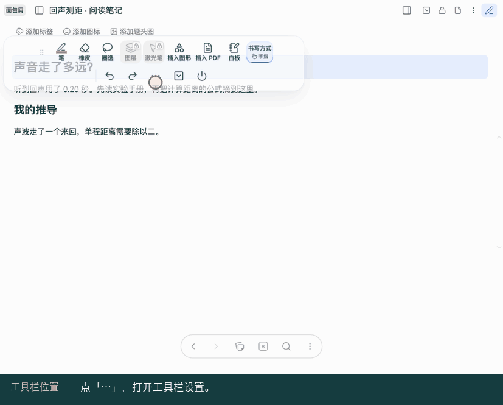

#### 工具栏主题

#### 工具栏配色

#### 备份与恢复

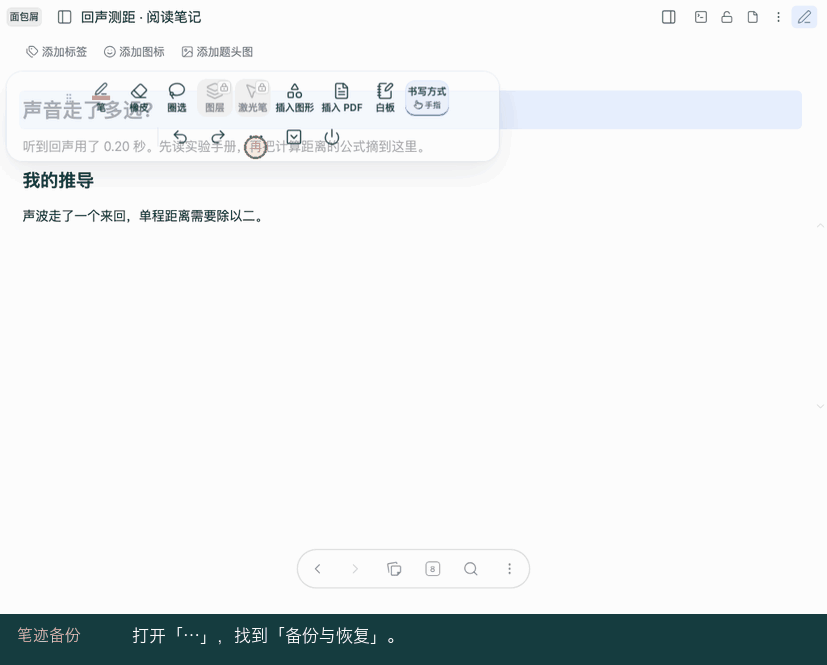

[使用指南](https://github.com/jiangeeeeee/siyuan-native-handwriting/blob/main/docs/使用指南.md) · [许可条款](LICENSE) · [第三方组件声明](THIRD_PARTY_NOTICES.md)

## 🕰 版本记录

| 版本 | 更新 |
| --- | --- |
| 0.15.0 | 缩短长正文和 PDF 的书写等待。手写工具栏可打开 PDF 大纲、页缩略图，新增六套外观和自定义主题色。 |
| 0.14.16 | 新增 PDF 手写、双指缩放、摘录引用和批注副本，加入工程图形与平板画笔面板。 |
| 0.14.15 | 修复白板上闪动的正文光标，以及侧栏伸缩后公式、图片附近的笔迹漂移。 |
| 0.14.14 | 增加悬停笔尖样式，把白板操作收进工具栏，合并重复的同步提示。 |
| 0.14.13 | 支持跨段落留白连续落笔，修复工具快捷键，调整激光笔和笔鼠切换。 |
| 0.14.12 | 白板支持粘贴图片，记住工具偏好，修复快捷键切换。 |
| 0.14.11 | 数位笔和鼠标可分工操作，修复抬笔误点图片和笔迹撤销问题。 |
| 0.14.10 | 增加矩形框选和白板底纹，改进连续书写与白板手势。 |
| 0.14.9 | 手写入口移到正文面包屑，减少连续落笔时的索引更新。 |
| 0.14.8 | 支持一篇笔记使用多张白板，降低正文笔迹的内存占用。 |
| 0.14.7 | 缩短连续书写和擦除密集笔迹时的等待。 |
| 0.14.6 | 长文档优先绘制可见笔迹，改善第一笔的响应。 |
| 0.14.5 | 合并同一文档的笔迹同步文件，备份只更新有改动的文档。 |
| 0.14.4 | 修复触屏擦除后切回画笔的问题，调整橡皮按钮的悬停效果。 |
| 0.9.1 | 提供正文批注、白板、钢笔、马克笔、橡皮、撤销重做和笔迹备份。 |
