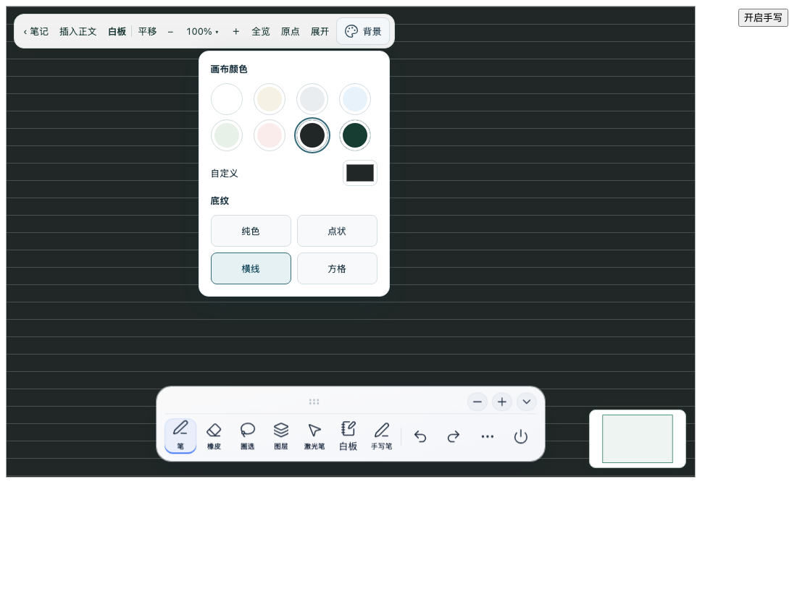
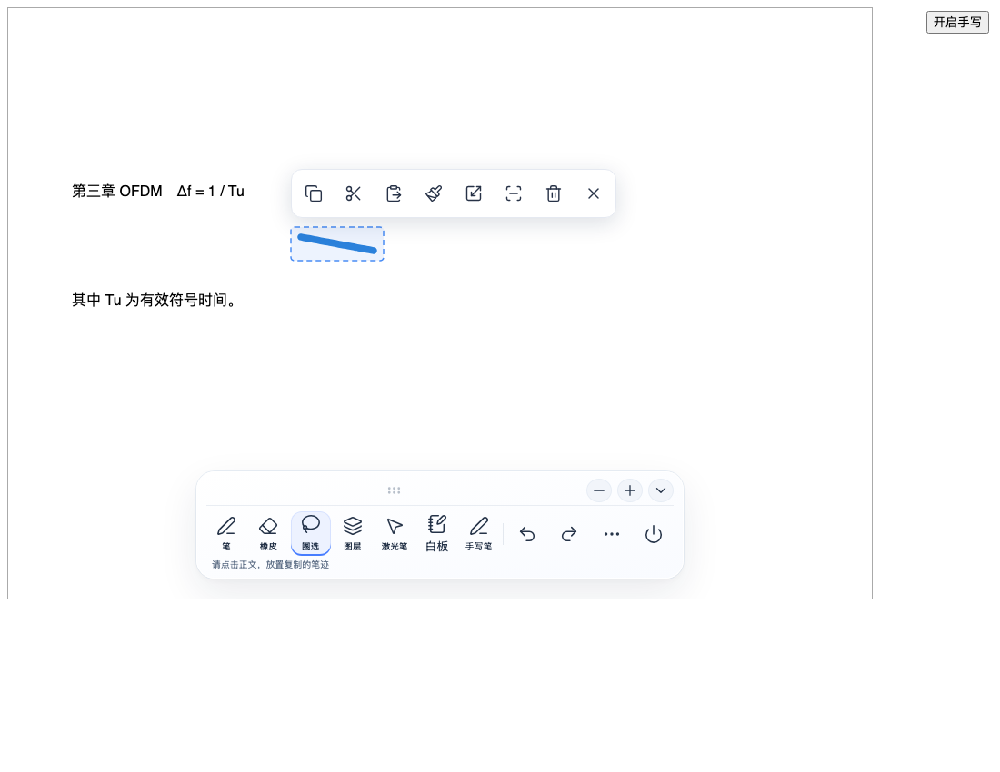
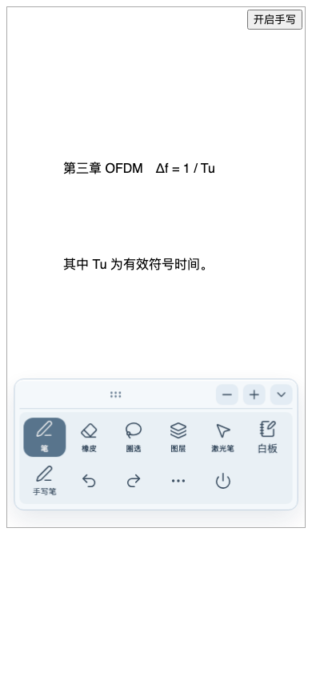

# 源生笔迹 0.14.10 功能测试报告

测试日期：2026-11-15。测试环境：macOS、Chromium；持续书写用例启用 4 倍 CPU 降速，触控手势通过浏览器触控事件执行。

## 本轮结果

类型检查与发行构建通过；70 项单元测试、129 项浏览器回归全部通过。

| 功能 | 步骤 | 结果 |
| --- | --- | --- |
| 持续书写与后台保存 | 连续书写 12 秒，同时安排约 16 MB 的编码任务；抬笔后等待保存完成 | 书写期间编码等待，停笔后完成；笔迹保留 |
| 白板多指手势 | 开启多指撤销重做，写一笔；双指轻点，再三指轻点；随后双指移动 | 撤销与重做各执行一次；移动只平移、缩放 |
| 套索与矩形框选 | 分别选择模式，选中笔迹后移动、剪切并粘贴 | 选区及笔迹正确，粘贴与取消同排 |
| 粘贴显示 | 未复制时圈选、删除；复制或剪切后再次选择 | 未复制时隐藏粘贴；复制、剪切后显示 |
| 白板底色与底纹 | 选择黑板底色和横线；保存、重载；导出 PNG | 配置恢复，PNG 带所选背景，笔迹未改变 |
| 多白板 | 同一文档新建、插入、切换两张白板，分别编辑后重开 | 两张白板分别保存，图片互不替换 |
| 工具栏外观 | 切换 6 种主题，在 1100 和 390 像素宽度下检查 | 图标、文字及按钮完整显示，无横向溢出 |
| 正文与擦除 | 3000 笔场景下书写、精确擦除、圈选擦除、撤销重做 | 数据与结果一致；长笔记只挂载附近笔迹 |
| 保存恢复 | 连续写入、模拟失败、重启、跨设备日志合并、备份恢复 | 新笔迹、删除记录及图层状态保留 |
| 其余功能 | 画笔、色卡、图层、激光笔、选区照片、PDF／HTML／SVG、面包屑入口、授权隔离 | 回归通过 |

## 连续书写测量

| 项目 | 实测值 |
| --- | ---: |
| 连续书写时长 | 12.01 秒 |
| 输入更新次数 | 723 |
| 最大帧间隔 | 19.1 ms |
| 95% 帧间隔 | 18.2 ms |
| 最大输入事件处理时间 | 5.7 ms |
| 停笔后编码完成的数据量 | 15.60 MiB |

这里测量的是桌面浏览器中的输入事件处理和帧间隔，不是触控笔到屏幕的硬件延迟。三星 Tab S9 Ultra 的连续书写停顿仍待真机复测。

## 临时内存减少的来源

旧代码统计撤销历史点数时会读取每笔的完整点数组。数组被回收后，这次读取会把压缩数据重新展开成大量对象。现在直接读取压缩数组的长度；保存编码也直接读取压缩数据，并在短时间片之间让出主线程，恢复书写时暂停。

下面统计 50 笔、共 25 万个点，每轮先回收可释放的缓存，再读取点数。运行 5 轮，取中位数。

| 单次点数统计 | 旧读取方式 | 新读取方式 |
| --- | ---: | ---: |
| 处理时间 | 2.507 ms | 0.010 ms |
| 临时 JS 堆分配 | 47.85 MiB | 616 字节 |

这项测量仅对应点数统计，不代表插件的总内存占用。保存文件仍按文档、白板与设备复用固定文件，未增加逐笔同步文件。

## 实际界面

