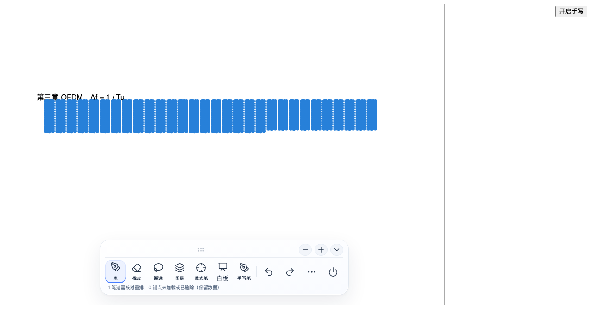
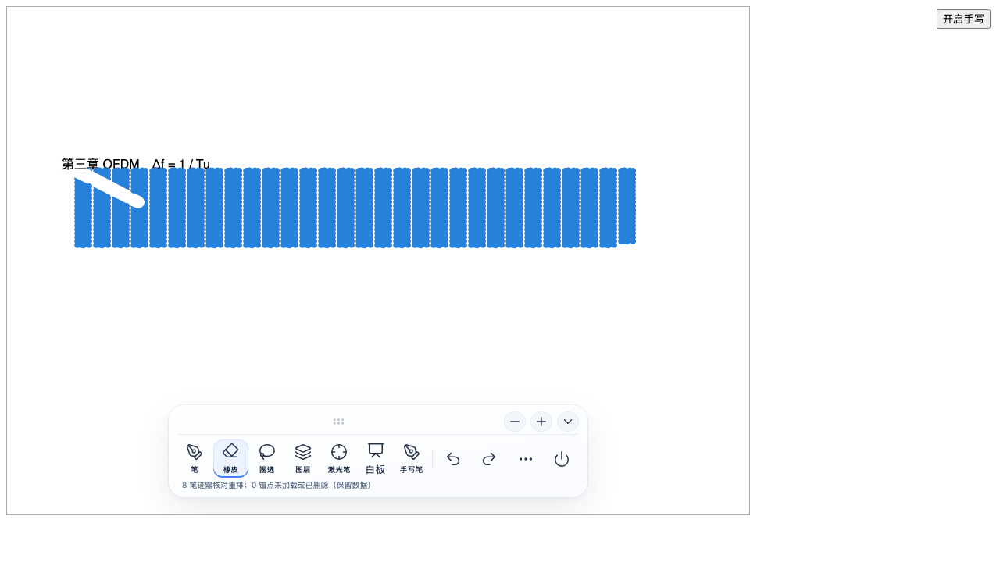
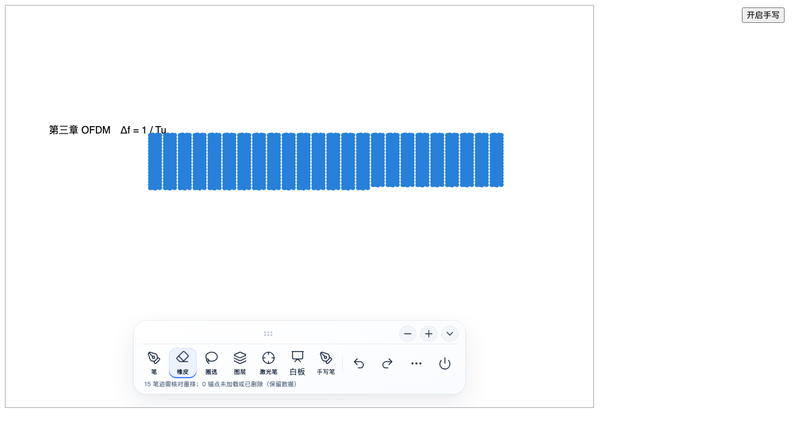

# 源生笔迹 0.14.7 书写与擦除延迟测试

测试日期：2026 年 11 月 9 日。对比版本：0.14.6 与 0.14.7。

## 本次修改

橡皮先按笔画范围、线段组和线段范围筛选，再做精确求交；重复擦除复用曲线，圈擦复用同一正文块的坐标转换。批量擦除统一登记恢复记录，分批写入本地恢复库，减少反复复制待保存列表。

连续书写减少绘制等待，抬笔后的撤销记录只处理本次变化。图层和路径顺序未变时复用已有结果。长笔画显示时减少冗余点、缩短 SVG 文本，保留转折和压感变化；原始采样不变，笔迹继续保持可编辑。整页文件保存等停笔约 750 毫秒后执行，本地恢复记录仍持续写入。

## 延迟对比

同一台 Mac、同一 Chromium 测试环境，CPU 限速 4 倍。每组预置 3,000 笔、每笔 128 个采样点；每种操作独立运行 3 次。书写共测 36 笔、432 次绘制检查；精确擦除记录 63 次命中处理，两个擦除模式各记录 3 次抬笔。

单位为毫秒。P95 表示 95% 的观测值不超过该值，最大值保留本次最慢一次。

| 操作 | 0.14.6 P95 | 0.14.6 最大 | 0.14.7 P95 | 0.14.7 最大 |
| --- | ---: | ---: | ---: | ---: |
| 连续书写：输入到绘制提交 | 17.3 | 21.1 | 17.1 | 21.0 |
| 起笔事件处理 | 8.5 | 15.8 | 10.8 | 11.3 |
| 抬笔提交 | 5.6 | 6.5 | 2.3 | 4.4 |
| 笔迹重绘提交 | 12.7 | 15.1 | 12.9 | 14.0 |
| 精确擦除命中处理 | 384.3 | 850.3 | 5.7 | 9.1 |
| 精确擦除抬笔处理 | 378.3 | 398.2 | 12.7 | 14.2 |
| 圈选擦除抬笔处理 | 1203.8 | 1249.2 | 12.6 | 20.2 |

橡皮阻塞和抬笔提交改善明显。连续书写的绘制提交 P95 仍约 17 毫秒，起笔 P95 在本次测量中略有增加，未观察到所有指标同时下降。表内计时来自浏览器模拟笔事件与程序提交，不是平板笔尖到屏幕亮起的硬件延迟；本场景未复现实机所述的 6 秒停顿。

## 功能校验

正式构建通过。62 项单元测试、110 项浏览器用例通过（完整回归 105 项，加原有实时画布专项 5 项）。

| 范围 | 验证内容 | 结果 |
| --- | --- | --- |
| 正文与白板书写 | 首笔、连续输入、压感线宽、实时画布到 SVG 的对齐、两万采样点长笔画 | 通过 |
| 擦除与编辑 | 精确、笔画、圈选擦除，重复擦除，圈选移动、缩放、换色、剪切、跨文档粘贴 | 通过 |
| 撤销与图层 | 批量擦除撤销重做，图层隐藏、锁定、删除、恢复 | 通过 |
| 白板与手势 | 白板移动、缩放、插入正文、双链开关，软件模拟多指与掌触事件 | 通过 |
| 导出与照片 | 正文加笔迹照片、透明笔迹照片、剪贴板入口、PDF、HTML、SVG | 通过 |
| 权限与界面 | 免费与 Pro 入口、授权验证、锁定提示、工具栏与颜色面板 | 通过 |
| 数据与恢复 | 保存重开、同步合并、备份轮换、旧文件整理、异常写入保留、批量删除持久化 | 通过 |
| 平板硬件 | 实际触笔到出墨、驱动压感与掌触、用户原笔记的 6 秒停顿 | 待实机复测 |

## 测试画面

3,000 笔密集笔迹作为起始数据。随后用精确橡皮沿左上区域拖动。

命中位置产生擦除遮罩，其余笔迹保留；撤销和重做后，笔画数量与擦除状态符合预期。

闭合圈住左上区域后，命中的笔画被删除；撤销恢复，重做再次删除。
