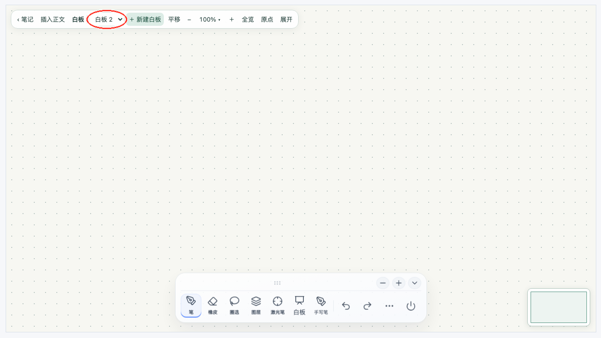
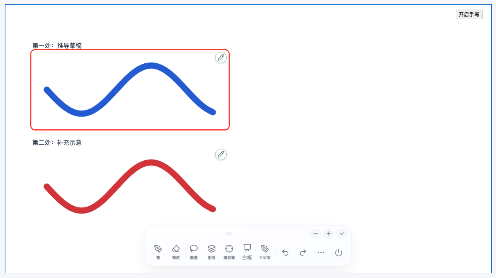
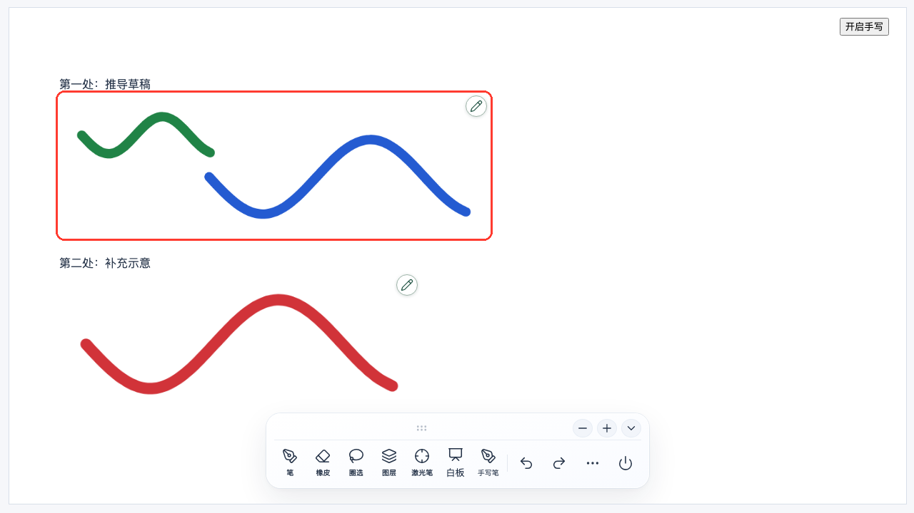

# 源生笔迹 0.14.8 稳定性与多白板测试

测试日期：2026 年 11 月 10 日。环境：macOS、Chromium；自动化接口使用隔离数据。正式构建通过，66 项单元测试、114 项浏览器用例通过。三星 Tab S9 Ultra 实机复测待完成。

## 正文书写的内存调整

| 项目 | 0.14.7 | 0.14.8 |
| --- | --- | --- |
| 同一页同时加载 | 可能重复读取、解析 | 合并为一次加载 |
| 不同页面读写 | 可同时保留多组解析、编码和校验数据 | 大块读写逐项执行 |
| JSON 保存 | 分块字符串复制到 Worker，再合并编码 | 直接以 Blob 编码分块，及时释放字符串列表 |
| 隐藏页面 | 保留实时画布和部分显示缓存 | 释放画布、路径和遮罩缓存，显示时重建 |
| 触控设备双画布预算 | 64 MiB | 24 MiB，预算下降 62.5% |
| 撤销记录 | 最多 50 次 | 最多 50 次，并按 25 万采样点限制历史；至少保留最近一次操作 |
| 白板预览 | 保留已发布笔迹数组引用 | 只保留弱引用的修订标记，预览生成后释放临时画布 |

原始笔迹仍可编辑；旧白板和图片地址保持兼容。这里的 24 MiB 是实时双画布预算，不是插件总内存。

触控模拟测试使用 1440 × 880 的书写区域、2 倍像素密度，分 8 组写入 800 笔。每组保存并完成垃圾回收后记录数据：

| 检查 | 结果 |
| --- | --- |
| 100 笔至 800 笔的实时双画布 | 均为 25,147,584 字节，约 24 MiB |
| 页面隐藏、恢复 15 次 | 每次隐藏后画布为 0，恢复后重新绘制 |
| 保存后重新读取 | 800 笔，与保存前一致 |
| 脚本异常 | 本场景未捕获到异常 |
| JS 堆占用 | 从约 6.0 MiB 增至 14.0 MiB，随笔迹增加；不含全部图形与宿主内存 |

## 多白板操作

### TC-001 · 新建与切换

在白板 1 写入红色笔迹，点击「＋ 新建白板」。

步骤1｜预期：得到独立空白画布；实际：列表切换到白板 2，笔迹数为 0，白板 1 保留。结果：通过。

### TC-002 · 两处分别插入

在白板 2 写入蓝色笔迹，插入正文第一处；再切回白板 1，插入第二处。

步骤2｜预期：两处显示不同白板；实际：正文有两张图片，资源地址和 PNG 内容不同。结果：通过。

### TC-003 · 独立编辑与重开

点第一张图片的编辑按钮，增加绿色笔迹，完成编辑；重启插件后再次打开。

步骤3｜预期：只更新白板 2；实际：第一张图片改变，第二张 PNG 字节不变。重开后蓝、绿笔迹均保留，两张白板均进入批量备份。结果：通过。

新建与切换白板属于免费功能；插入正文、双链设置仍需 Pro。创建失败时保留原白板及笔迹。

## 功能回归

| 范围 | 检查内容 | 结果 |
| --- | --- | --- |
| 正文书写 | 首笔、连续落笔、长笔画、跨块、滚动、压力采样 | 通过 |
| 编辑 | 精确擦除、笔画擦除、圈选擦除，移动、换色、缩放、剪切、跨文档粘贴 | 通过 |
| 撤销与图层 | 撤销重做、批量擦除恢复、图层显隐与锁定 | 通过 |
| 白板 | 新建、切换、独立插入及编辑、旧白板、双链开关、平移缩放 | 通过 |
| 照片与导出 | 选区照片、正文照片、DPI、剪贴板入口、PDF、HTML、SVG | 通过 |
| 存储与恢复 | 并发加载、读写排队、写入失败重试、保存重开、备份、合并及旧数据整理 | 通过 |
| 授权与界面 | 免费与 Pro 范围、账号验签、锁定入口、工具栏主题及色盘 | 通过 |
| 输入与生命周期 | 模拟触笔和多指事件、捕获丢失、编辑器替换、隐藏恢复、插件启停 | 通过 |
| Android 真机 | 原笔记持续书写、系统重启、实际压感及掌触 | 待 Tab S9 Ultra 复测 |

另以 3,000 笔、每笔 128 个采样点、CPU 限速 4 倍，检查书写、精确擦除和圈选擦除，各重复 3 次；操作及撤销重做断言通过。

## 闪退判断与复测

用户反馈的退出发生在 Tab S9 Ultra 正文书写中，未打开白板。目前没有这台设备的崩溃日志，无法判定是系统回收 WebView、原生崩溃，还是插件错误。12GB 是整机内存，不能据此排除 WebView 内存压力；Android 的 `didCrash()` 和系统日志可用于区分退出类型。参见 [Android WebView 进程退出说明](https://developer.android.com/reference/android/webkit/RenderProcessGoneDetail)。

本版处理了上述代码中的内存占用问题，并在「更多手写操作 → 备份与恢复 → 输入诊断」加入最近 20 条本地运行记录，只记录计数、时间和错误类型。请在原笔记继续书写；若再次重启，记下时间，重开后复制诊断内容。诊断有助于缩小范围，最终原因仍需结合 Android 日志判断。

平板复测图片：待补充。
