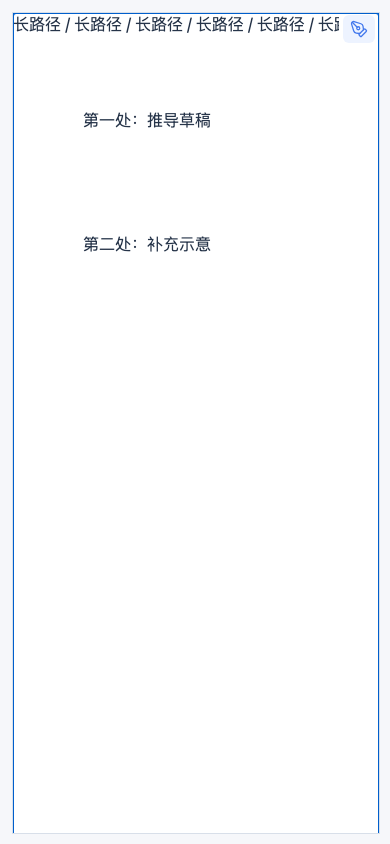

# 源生笔迹 0.14.9 测试记录

测试日期：2026-11-13。构建检查、67 项单元测试和 118 项浏览器用例通过。

## 本轮改动与验证

| 项目 | 操作 | 结果 |
| --- | --- | --- |
| 面包屑入口 | 在 390px 窄屏中开启、关闭手写，重绘长路径 | 按钮保持可见，无重复入口 |
| 多编辑器 | 分别操作两个编辑器，在只读模式中检查入口 | 只切换对应笔记；只读时禁用 |
| 圈选删除 | 圈选并删除，检查菜单与剪贴板 | 不显示空粘贴按钮，不复制被删笔迹 |
| 复制与剪切 | 复制、剪切，再切换笔记粘贴 | 显示粘贴，笔迹可跨笔记放置；删除不改写已有复制内容 |
| 增量索引 | 3,000 笔中新增、删除、移动笔迹；连续修改超过 2,048 次 | 单次更新不读全量列表；记录超限后重建正确 |
| 页面缓存 | 连续书写 800 笔，隐藏、显示页面 15 次，再重新加载 | 隐藏时画布和空间索引释放，重开仍为 800 笔，无页面错误 |
| 完整回归 | 画笔、压感、三种擦除、圈选编辑、图层、激光笔、多白板、缩放、导出、备份与恢复、免费与 Pro 授权 | 既有用例通过 |
| 本机安装 | 安装正式包并点按思源面包屑入口 | 可开启、关闭；278 个笔迹文件哈希一致 |

## 延迟对照

同一台 Mac、同一 Chromium，CPU 4 倍降速；每项 3 轮，初始 3,000 笔，每笔 128 个采样点。表中为合并样本的 P95。两版独立运行。

| 指标 | 0.14.8 | 0.14.9 |
| --- | --- | --- |
| 落笔事件处理 | 6.7 ms | 7.9 ms |
| 移动事件处理 | 0.6 ms | 0.6 ms |
| 书写期间历史重绘 | 15.4 ms | 13.9 ms |
| 事件到画布出墨 | 17.2 ms | 17.1 ms |
| 精确擦除收尾 | 15.3 ms | 14.5 ms |
| 圈选擦除收尾 | 15.4 ms | 15.6 ms |

本轮主要减少落笔后的全量索引扫描，历史重绘耗时下降。持续出墨基本持平，落笔事件和圈选擦除收尾未测得改善。这些数字是浏览器处理耗时；三星 Tab S9 Ultra 的端到端延迟仍需实机复测。

## 内存处理

空间索引从每次遍历整篇笔迹改为按变更 ID 更新，变更记录上限 2,048 条，不保留被替换的笔迹对象。隐藏页面释放索引，重新显示时按当前数据重建。剪贴板复用已校验内容，粘贴时不再先完整复制一遍采样点再重新生成坐标。

触控尺寸压力测试的实时双画布维持约 24 MiB 上限；隐藏后降至 0，索引块数也为 0。800 笔保存后重开数量一致。

长路径在独立区域滚动，右侧手写入口仍可点按。
