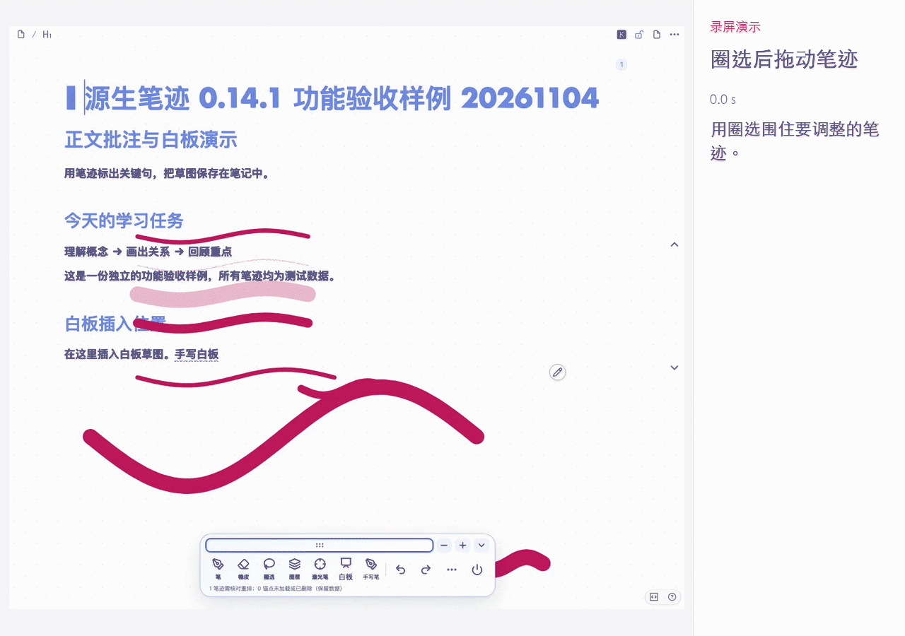
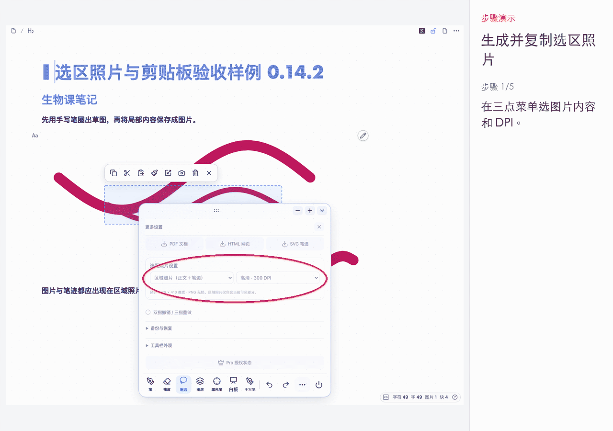
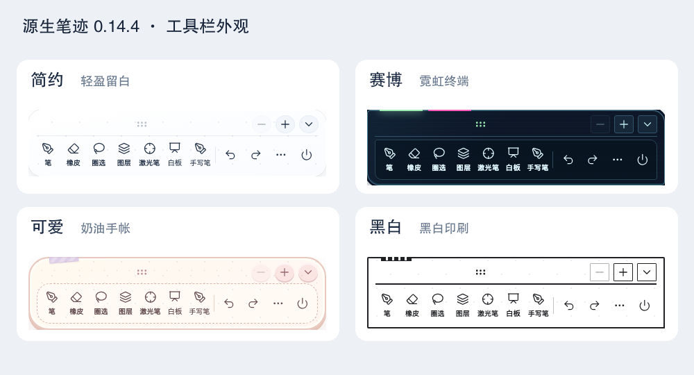
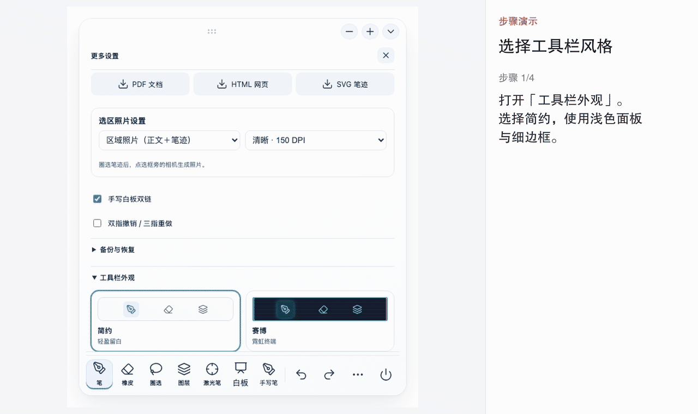
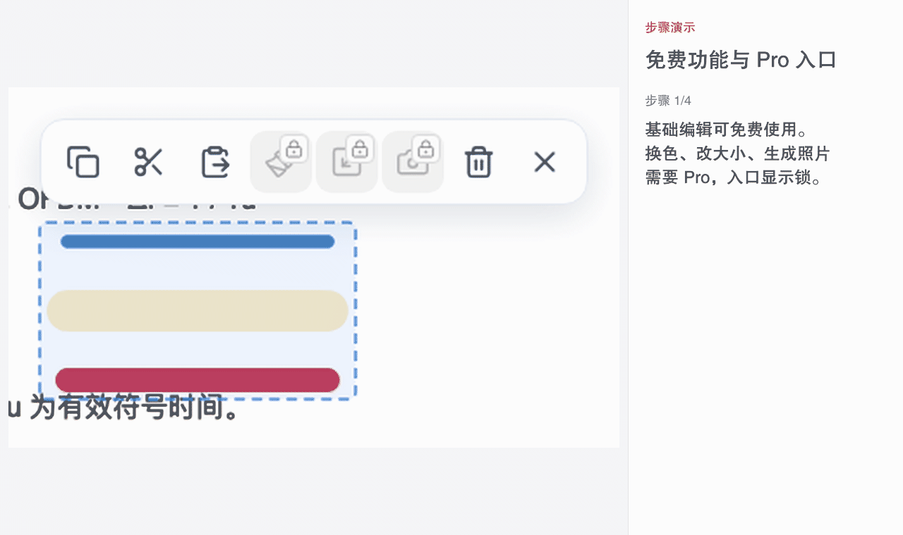

# 源生笔迹 0.14.4 使用指南

在思源正文上画线批注，也可以打开白板画草图，再把白板插入笔记。适用于思源 3.8.4 及以上版本。

## 开始书写

1. 安装插件，在思源「设置 → 集市 → 已下载 → 插件」中启用「源生笔迹」。
2. 打开笔记，点击顶栏手写笔图标。
3. 点击「笔」，选择钢笔、马克笔或彩笔，调整颜色和粗细后开始书写。铅笔需要 Pro。
4. 面板右上角的叉可以收起设置。点「手写笔」切换为手指模式后，也可用手指书写。

笔迹自动保存，重新打开原笔记可继续编辑。桌面鼠标也可以书写。

## 选择画笔与颜色

钢笔适合书写，马克笔使用半透明线条标记正文，彩笔用于彩色线条，铅笔带颗粒笔触。切换笔型后会保留各自的参数和色卡。

点击圆形色卡选择颜色；输入 HEX 色值后，点「保存当前颜色」可加入当前色卡。展开色盘可调整色轮与明度。[查看画笔演示](demos/02-brushes.gif)。

## 擦除和整理笔迹

「精确擦除」擦去经过的局部，「笔画擦除」删除碰到的整笔。两者免费可用，圈选擦除需要 Pro。工具栏上的撤销、重做可恢复编辑操作。

点「圈选」围住笔迹，拖动选框内部即可移动。复制、剪切、粘贴和删除免费可用；点「粘贴」后，再点正文中的放置位置。复制的笔迹也可粘贴到其他笔记。

选区小菜单中的「换色」「改大小」和相机需要 Pro。换色共用画笔色盘；改大小可用滑块或选框缩放点。[查看缩放和复制演示](demos/04-selection-edit.gif)。

## 生成照片并复制到其他应用（Pro）

1. 在「… → 选区照片设置」选择「区域照片（正文＋笔迹）」或「仅笔迹（透明背景）」。
2. 选择 96、150、300 或 600 DPI。设置会自动保存。
3. 圈选笔迹，点击选框旁、与「换色」「改大小」并列的相机。
4. 在预览中选择「保存到剪贴板」「保存到思源资源」或「下载 PNG」。复制后可到支持图片的应用中粘贴。

区域照片截取选区内当前可见的正文与笔迹。要导出整篇内容，使用 PDF 或 HTML。PNG 为无损图片；大选区的最长边限为 4096 像素、总像素不超过 800 万，实际尺寸以预览为准。

## 使用白板

点「白板」进入画布。书写、擦除、移动视野和缩放均可免费使用。双指分开时放大、靠拢时缩小；桌面可用「平移」工具和缩放按钮，也可点击百分比输入比例。「全览」找回全部笔迹，「原点」恢复初始视野。

[查看白板缩放演示](demos/06-whiteboard-zoom.gif)。白板双指用于缩放；正文的双指撤销、三指重做可在三点菜单开启，需要 Pro。

插入正文需要 Pro。先在正文点好插入位置，再打开白板书写，点「插入正文」。点图片上的手写笔可再次编辑，完成后更新原图。同一篇笔记共用一份白板。

在「… → 手写白板双链」控制是否创建双链。开启后插入白板图片及双向引用；关闭后只插入图片，仍可继续编辑。开关默认开启，关闭后不删除已有双链。

## 图层与激光笔（Pro）

点「图层」新建图层，将不同内容分开管理。隐藏图层可暂时收起笔迹，锁定后不能在该层继续书写。[查看图层操作](demos/08-layers.gif)。

激光笔用于讲解时的临时指示，轨迹自动消退，不写入笔迹数据。[查看激光笔演示](demos/09-laser.gif)。

## 工具栏外观（Pro）

在「… → 工具栏外观」选择简约、赛博、可爱或黑白。简约采用浅色留白；赛博使用深色霓虹；可爱带奶油色和手帐装饰；黑白采用印刷感边框。

「主题强调色」使用完整色盘，支持色卡集、色轮、明度和 HEX。工具栏与画笔共用已保存的色卡集，各自记住所选颜色；调整工具栏配色不会改变笔迹颜色。黑白风格保持灰度，强调色供其他风格使用。

长按六点手柄可移动工具栏，上方加减按钮调整大小；折叠后可点浮动手写按钮恢复。[查看外观选色](demos/11-toolbar-palette.gif)。

## 导出、备份与保存位置

在三点菜单中导出带笔迹的 PDF、HTML，或单独的 SVG 笔迹，需要 Pro。

「备份与恢复」免费可用。点「导出备份」保留可编辑数据，点「导入备份」预览并恢复对应文档；「高级：单篇笔迹数据」提供单篇 JSON 导出和恢复。

笔迹、设置及备份保存在当前思源工作空间的插件数据中。「保存到思源资源」写入工作空间资源目录；下载 PNG、PDF 等文件时使用当前客户端的下载位置。卸载插件或迁移工作空间前，可先导出笔迹备份。

## 免费版与 Pro

| 功能 | 免费版 | Pro |
| --- | --- | --- |
| 钢笔、马克笔、彩笔及其颜色和参数 | 可用 | 可用 |
| 铅笔 | 需解锁 | 可用 |
| 精确擦除、笔画擦除 | 可用 | 可用 |
| 圈选擦除 | 需解锁 | 可用 |
| 圈选、移动、复制、剪切、粘贴、删除 | 可用 | 可用 |
| 选区换色、缩放、生成照片 | 需解锁 | 可用 |
| 激光笔、图层管理 | 需解锁 | 可用 |
| 白板书写、移动视野、缩放 | 可用 | 可用 |
| 白板插入正文、双链开关 | 需解锁 | 可用 |
| 手写笔／手指输入切换 | 可用 | 可用 |
| 正文与笔迹 PDF、HTML 和 SVG 笔迹导出 | 需解锁 | 可用 |
| 双指撤销、三指重做 | 需解锁 | 可用 |
| 工具栏外观、主题强调色 | 需解锁 | 可用 |
| 按钮撤销重做、笔迹备份与恢复 | 可用 | 可用 |

灰白色并带锁的入口需要 Pro，点击后打开授权窗口。

笔迹 Pro 授权码在淘宝[铛铛学长的小店](https://m.tb.cn/h.jSTvJj45DK7IVMR)购买，价格为 **¥29.9／永久**。授权窗口也提供「前往淘宝购买」入口。

1. 复制授权窗口中的「当前思源账号 ID」。
2. 购买后将 ID 发给店铺客服，取得对应的 HW1 授权码。
3. 回到授权窗口，粘贴完整授权码，点「激活 Pro」。

同一思源账号可在多台设备使用相同授权码。激活在本机完成签名校验，无需用户部署授权服务器。解锁后锁标记消失；清除本机授权后恢复锁定，已有笔迹保留。

## 常见操作

- 照片按钮在哪里：先圈选笔迹，相机在选区小菜单中；三点菜单只设置照片内容和 DPI。
- 手指只能移动白板：点「手写笔」切换为手指输入后再写。
- 工具栏挡住内容：拖动六点手柄，或用上方加减号调整大小。
- 笔侧键设置在哪里：本版暂不提供笔品牌和功能键映射。

[查看全部动图](动图索引.md)
